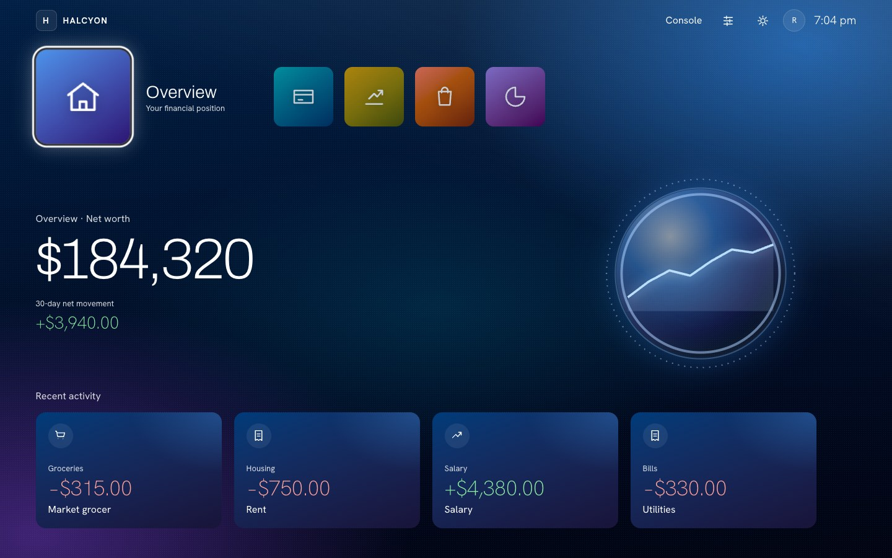

# Console Phase 2 · Gate 1

| Reproduction field | Value |
| --- | --- |
| Branch | `Revamp/ps5` |
| Application commit | `5ab48d191216cf34f7c0a0337c3b270ed01a7ae6` |
| Worktree | `/Users/joel/Developer/fin-app` |
| URL | [http://127.0.0.1:5320/dashboard](http://127.0.0.1:5320/dashboard) |

```bash
cd /Users/joel/Developer/fin-app/app
CHOKIDAR_USEPOLLING=1 npm run dev -- --host 127.0.0.1 --port 5320 --strictPort --force
```



Sign in through the ordinary login form, then select **Console** on Dashboard. If port 5320 already has a listener from an earlier review, stop that listener before starting the command. I restarted it and verified that the normal HTTP responses import `ConsoleViewport`, `ConsoleHome` and `ConsoleHub` from the worktree. This matters because the old listener still returned modules with the deleted spike names. The review browser uses the same signed-in routes and replaces Auth and read responses at the API boundary with fictional data.

## Captures

| State | 1440×900 | 390×844 |
| --- | --- | --- |
| Home, Overview selected | [Desktop](captures/console-phase-2-foundation/1440-home-overview.jpg) | [Phone](captures/console-phase-2-foundation/390-home-overview.jpg) |
| Income hub, expanded | [Desktop](captures/console-phase-2-foundation/1440-income-expanded.jpg) | [Phone](captures/console-phase-2-foundation/390-income-expanded.jpg) |
| Income hub, compact | [Desktop](captures/console-phase-2-foundation/1440-income-compact.jpg) | [Phone](captures/console-phase-2-foundation/390-income-compact.jpg) |
| Overview hub, expanded | [Desktop](captures/console-phase-2-foundation/1440-overview-expanded.jpg) | [Phone](captures/console-phase-2-foundation/390-overview-expanded.jpg) |

Home and the hubs retain the 2c layout, figures, chart series and ambient colours. Tinted hub surfaces now use the shared 24px blur when effects are on, which softens the grain beneath them. Tables and long lists keep their opaque surfaces. The focus ring uses the same gap and edge across controls, and focused or hovered activity cards gain a small scale and a sweep. The captures pause decorative loops at rest so the comparison shows stable paint.

The compact header covers scrolling content with an opaque reading area that spans the viewport. The fade begins below the text and controls. The calculated contrast is about 18.6:1 for white text on the two dock colours, and at least 8.6:1 for the 85%-white label against either dock colour with up to 17% white control fill. Spending insights and Income activity use white accents, insight sentences use neutral text, signed money retains colour and a sign, and the allocation label reads “Gross assets.”

## Checks

The branch was already based on local `main` at `609fc12` when rebased. The Playwright suite covers the four states above at both sizes, including keyboard previews and activation, two-tap touch activation, focus return, the opaque dock, live appearance switching, reload and blocked preference storage. The development demo verifies the ring, roving focus, disabled cards, full and reduced effects, and a live change to the operating-system motion preference. The Classic smoke checks rendering, navigation and browser errors. All eight Playwright cases passed in Chrome 157. Axe found zero WCAG 2.0 or 2.1 A/AA violations across the eight state and viewport combinations. Frontend and browser test TypeScript checks and the production build passed. The offline suite passed all 728 tests after restoring router context to the existing Dashboard unit fixture. The build still emits its existing large-chunk warning.

Use the signed-in [foundation demo](http://127.0.0.1:5320/dashboard?demo=foundation) with Console selected. Run `npx playwright test --config playwright.console.config.ts` from `app/` while the dev server is running. Desktop and phone screenshots plus the axe results attach to the test run.

The [Mac Chrome DevTools trace](traces/console-phase-2-foundation-chrome.json.gz) records on-port keyboard and mouse previews, a single-click Income entry, the collapse and re-expansion, and Back. It covers the combined foundation build. Ambient cost and physical-device timings belong to the later performance gates.

The Gate 1 routes exercise appearance switching and persistence. Changing appearance still remounts the presentation shell, so in-progress drafts inside other views were outside this verification. The full material stack, startup and sound, and Control Centre hardening remain at their scheduled gates.
