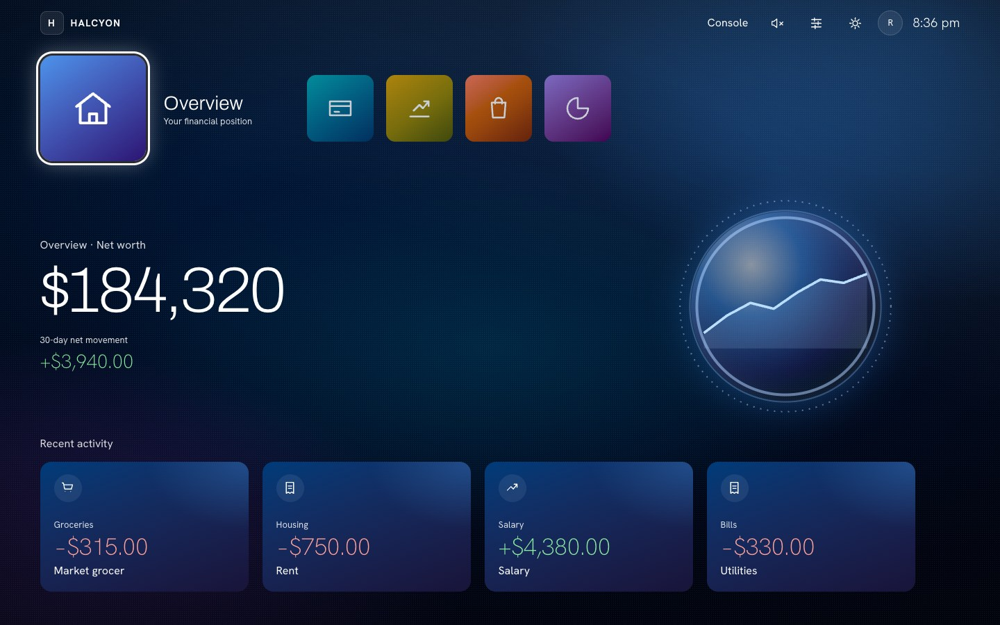

# Console Phase 2 · Gate 2

| Reproduction field | Value |
| --- | --- |
| Branch | `Revamp/ps5` |
| Application commit | `4bd69d00d43c2ea0066d6980a94e545e1243cc69` |
| Worktree | `/Users/joel/Developer/fin-app` |
| URL | [http://127.0.0.1:5320/dashboard](http://127.0.0.1:5320/dashboard) |

```bash
cd /Users/joel/Developer/fin-app/app
CHOKIDAR_USEPOLLING=1 npm run dev -- --host 127.0.0.1 --port 5320 --strictPort --force
```



Open the URL, sign in, and choose **Console**. Settings contains **Console effects and sound**. Enable **Show start screen** and **Console sound**, then reload Dashboard to see the start screen. **Reduce effects** is in the same Settings module. The speaker in the top bar enables sound on first use and mutes or unmutes it thereafter. Control Centre offers the independent **Ambient music** toggle. Sound and music both start off, and the initial volume after opt-in is 55%.

The review browser signed in through the ordinary app and supplied fictional Auth and reporting responses at the local API boundary. The listener’s working directory and served Console modules were checked after restarting it.

## Walkthrough with sound

[30-second signed-in walkthrough with stereo audio](captures/console-phase-2-effects/walkthrough-with-audio.mp4). It shows startup, browsing Overview through Expenses, opening Income, scrolling to the compact header, returning Home, opening Control Centre, and enabling music. The audio track is the app compressor’s live output recorded alongside the browser video. No soundtrack or replacement cues were added.

## Ambient performance

The [Chrome DevTools trace](traces/console-phase-2-effects-chrome.json.gz) compares the full scene with Reduce effects on the same 1440×900 Home viewport, in Chrome 157.0.8103.80 on the local arm64 Mac. Both windows follow the same pointer path and are marked `console.gate2.full` and `console.gate2.reduced`. The estimate sums outer CPU tasks on the renderer main, renderer compositor, Viz compositor, and GPU service threads per refresh interval. It includes Chrome’s trace overhead and reports CPU time, including GPU submission, rather than GPU hardware execution time.

| Measure | Full scene | Reduce effects |
| --- | ---: | ---: |
| Sampled refresh intervals | 240 | 242 |
| Mean combined Chrome CPU work per frame | 1.96 ms | 0.34 ms |
| p95 combined Chrome CPU work per frame | 2.58 ms | 0.72 ms |
| p95 frame interval | 16.8 ms | 16.7 ms |

The full scene adds about **1.62 ms per frame on average** against the 2 ms ambient budget. The combined p95 is above 2 ms. Particle positions and twinkle sample at 30 Hz on a scaled raster. The overall scene still composed at about 60 Hz during the trace. The physical-device performance checks remain at the ends of Phases 3 and 5.

## Checks and scope

All 16 Playwright cases passed using `npx playwright test --config playwright.console.config.ts` from `app/`. Coverage includes the Console dates, both choices in the appearance confirmation, audio consent and reload, the system motion preference, the optional startup and modal scene suspension. Axe reported zero violations across the carried Home and hub states. The 730 offline tests, both TypeScript checks and the production build passed.

The fixture uses day-first range labels, short monthly axis labels and years at year boundaries. A mounted editor that reports unsaved changes prompts before an appearance switch. Dismissal keeps the edits in place; confirmation remounts the shell. The phone header and orb refinements are recorded for their later phases. Control Centre uses its existing modal and shortcuts pending Batch 3 qualification.
