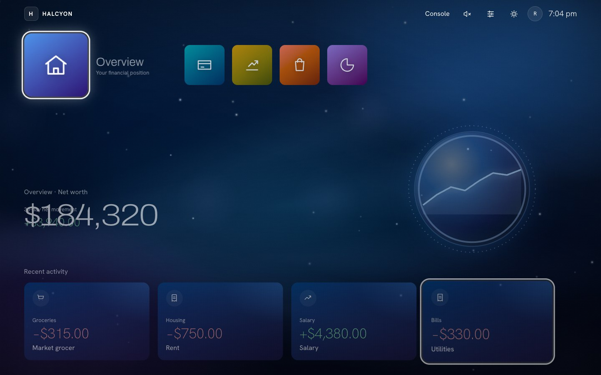

# Console Phase 2 · Gate 3

| Reproduction field | Value |
| --- | --- |
| Branch | `Revamp/ps5` |
| Application commit | `0ba234dc9bc46b5e683e5652316efcd48166d8e6` |
| Worktree | `/Users/joel/Developer/fin-app` |
| URL | [http://127.0.0.1:5320/dashboard](http://127.0.0.1:5320/dashboard) |

```sh
cd /Users/joel/Developer/fin-app/app
CHOKIDAR_USEPOLLING=1 npm run dev -- --host 127.0.0.1 --port 5320 --strictPort --force
```



Sign in, select **Console**, and press **C** or select **Control Centre** in the top bar. Settings exposes **Effects tier**, **Master volume**, the optional start screen, and the **C** shortcut preference. The captures use the real app entry with fictional responses at the Auth and reporting API boundary.

[Opaque start screen](captures/console-phase-2-gate-3/1440-opaque-start.jpg) · [Balanced Home](captures/console-phase-2-gate-3/1440-balanced-dashboard.jpg) · [Forced colours](captures/console-phase-2-gate-3/1440-forced-colours.jpg)

[Control Centre at 320px](captures/console-phase-2-gate-3/320-control-centre.jpg) · [390px](captures/console-phase-2-gate-3/390-control-centre.jpg) · [768px](captures/console-phase-2-gate-3/768-control-centre.jpg) · [1024px](captures/console-phase-2-gate-3/1024-control-centre.jpg) · [1440px](captures/console-phase-2-gate-3/1440-control-centre.jpg) · [200%-equivalent reflow](captures/console-phase-2-gate-3/zoom-reflow-200-centre.jpg)

## Master volume

[Listen to the same Control Centre cue at 55%, then 15%](captures/console-phase-2-gate-3/master-volume-55-then-15.m4a). The peak fell from −21.6 dBFS to −32.5 dBFS. At 0% the captured output was silent. The capture taps the actual compressor output and preserves the app gains. The Gate 2 listening review remains with the owner.

## Chrome trace

[Download the Full, Balanced and Reduce-effects Chrome trace](traces/console-phase-2-gate-3-chrome.json.gz). The marked windows replay the same pointer path at 1440×900 in local arm64 Mac Chrome 157.0.8103.80. The estimate sums CPU work on the renderer main thread, renderer compositor, Viz and GPU service threads. It includes GPU submission and tracing overhead. It measures CPU time rather than time spent executing on the GPU itself.

| Measure | Full | Balanced | Reduce effects |
| --- | ---: | ---: | ---: |
| Refresh intervals sampled | 240 | 240 | 241 |
| Mean combined Chrome CPU work per frame | 2.27 ms | 2.15 ms | 0.50 ms |
| Mean added CPU work against Reduce effects | 1.77 ms | 1.65 ms | — |
| p95 combined Chrome CPU work per frame | 3.21 ms | 3.08 ms | 0.94 ms |
| p95 refresh interval | 16.7 ms | 16.8 ms | 16.7 ms |

Balanced meets the 2 ms budget on average relative to the static scene. The trace does not establish a 2 ms ceiling on every frame. The longest renderer main-thread task in the marked navigation sequence was 18.5 ms.

## Phase 2 acceptance matrix

| Item | Result | Evidence |
| --- | --- | --- |
| Both appearances and live switching | Pass | Console renders from the real signed-in route. The Classic smoke test renders, navigates and checks console errors. Appearance and explicit effects preferences survive reload. Reported unsaved changes prompt before switching. |
| Startup and motion | Pass | Home stays unmounted while the opaque start screen is present, including during its exit. Reduced mode has a stable prompt and 150ms fade. Shared CSS and Framer Motion timings still use the same token definitions. |
| Tile paint and navigation | Pass | Browser checks sample the incoming silhouette during its fade and verify an opaque base. Keyboard previews and activation, two-tap touch opening and Back focus return pass. |
| Control Centre and responsive layout | Pass | Full-width sheet, focus wrap, focus restore, Escape, C, editable fields, another modal and the persisted shortcut preference pass. Touch labels are visible. The 200% check uses its equivalent 720×450 CSS viewport at 2× capture scale. |
| WCAG checks and signed figures | Pass on sampled states | Axe found no A/AA violations on the checked Home, hubs and Control Centre states. The lowest sampled ratios under visible signed amounts were 7.13:1 for Overview negatives, 7.04:1 for Income positives and 5.84:1 for Spending negatives. Both inks exceeded 6.46:1 on the sampled Account card paint. Budget has no signed figure in the Home preview. The samples cover the painted text regions, with signs still visible independently of hue. |
| Effects | Pass on checked states | Coarse pointers, four logical cores, a 4 GB device-memory signal and Save-Data each select Balanced. The higher-spec fine-pointer fixture defaults to Full. Full can be forced and persisted. Balanced has 20 particles, static ribbons, moving rays and beam, and opaque glass. Reduce effects removes particles and backdrop blur. Scene work pauses under an overlay and when the document reports hidden. It resumes on visibility return. |
| Audio and settings | Pass | Fresh setup is silent. Consent and mute persist, and audio waits for a gesture after reload. OS reduced-motion override, unavailable Web Audio, music, volume and zero output were exercised. |
| Animation properties | Pass for Console primitives | Inspected the Console animation targets for transform, opacity and filter. Tile paint stays opaque through the cross-fade and Control Centre uses a transform and opacity entry and exit. |
| Focus-induced layout shift | Pass | A separate signed-in observation recorded zero layout shifts while previewing tiles. The Income route and Home return had data-driven layout shifts after mounting, including a Home return shift of 0.016 without recent input. |
| Navigation task length and refresh cadence | Pass in local Chrome | Longest renderer main-thread navigation task was 18.5 ms. The 60 Hz sample maintained a 16.7–16.8 ms p95 refresh interval. |
| Ambient 2 ms ceiling on every frame | Fail to establish | Balanced added 1.65 ms per frame on average. Combined Chrome CPU work at p95 was 3.08 ms, so the trace cannot certify the ceiling on each frame. |
| Physical device qualification | Deferred | The 2020 M1 MacBook Air Safari and Pixel 6a Chrome gates are scheduled for Phases 3 and 5. |

All 30 Playwright cases and 730 offline tests passed. Frontend and browser TypeScript checks and the production build passed.
