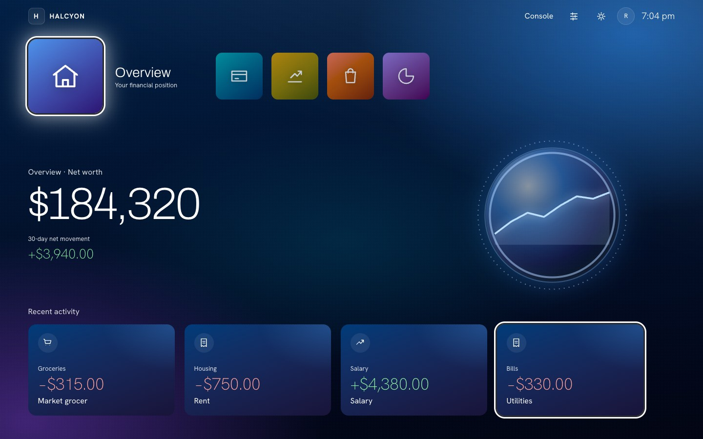

# Console review on port 5320

| Reproduction field | Value |
| --- | --- |
| Branch | `Revamp/ps5` |
| Application commit | `e6a88f77a2df2b649712a41218684783fbd64d00` |
| Worktree | `/Users/joel/Developer/fin-app` |
| Dev server working directory | `/Users/joel/Developer/fin-app/app` |
| URL | [http://127.0.0.1:5320/dashboard](http://127.0.0.1:5320/dashboard) |

```bash
cd /Users/joel/Developer/fin-app/app
CHOKIDAR_USEPOLLING=1 npm run dev -- --host 127.0.0.1 --port 5320 --strictPort --force
```



Start that command after stopping the old dev listener if it still owns port 5320. Open the Dashboard URL, sign in through the ordinary login form, then choose **Console**. The viewport shell has the Halcyon brand, Console switch, Control Centre, Settings, avatar and clock. The captures sign in through the same route in a recording browser that supplies fictional Supabase API responses. Both browsers receive the same HTML, modules, routes and shell from port 5320.

## Checkout comparison

The primary worktree in the app repository is `/Users/joel/Developer/fin-app`, checked out on `Revamp/ps5`. The pre-fix HEAD in that worktree was `d6562ca2bebcba2b8ad548bdcdfab31ec82b383e`. The local app repository’s `main` ref was `609fc129330e6bf4f2a8c6853b74e7be419bb19a`, with no worktree attached to that ref. Its other registered worktrees were:

| Worktree | Branch | HEAD |
| --- | --- | --- |
| `/Users/joel/Developer/fin-app/.claude/worktrees/dreamy-lamport-995818` | `claude/budget-assistance-ui-green` | `456009a` |
| `/Users/joel/Developer/fin-app/.claude/worktrees/quizzical-meninsky-539fc8` | `claude/quizzical-meninsky-539fc8` | `475ccda` |

The Obsidian project copy at `/Users/joel/Documents/Obsidian/personal-brain/01_Projects/fin-app` belongs to the separate `personal-brain` repository on `main` at `91ff8f8dfeb320b901f1785e569df1f46bb7116e`. Port 5300 is serving the Obsidian copy. Port 5320 was already running from the Developer checkout, and the replacement listener PID 79573 uses that same directory.

## Cause and verification

Vite PID `68086`, launched at 14:09 AEDT on 22 November using `npm run dev -- --host 127.0.0.1 --port 5320`, was still serving cached Phase 2a transforms from its first launch. An ordinary HTTP response from `/src/App.tsx` contained the old `consoleDashboard` flag. The same source request with a new query parameter contained the current `consoleViewport` code. The older `Dashboard.tsx` and `Shell.tsx` responses likewise contained the band button and toggle. The signed-in personal tab reproduced the old shell on the ordinary URL. That sequence isolates the stale transform to the running listener.

Phase 2b removed the band in `6319bd0`. The current source has one Console entry through `ConsoleViewportSpike`, and the old band selectors and action are absent. I stopped PID `68086`, restarted Vite on the same port with filesystem polling enabled, and verified the ordinary HTTP responses again. The real account’s existing session loaded the viewport at the same URL. A Classic → Console round trip showed the Classic rail in Classic and the standalone Console viewport in Console. Opening Overview located the controls inside Spending insights. Back returned to `/dashboard`.

## Capture set

| Check | Capture |
| --- | --- |
| Overview hero with the filter controls moved into the report module | [Overview hero](captures/console-5320-review/overview-hero.jpg) · [Spending insights](captures/console-5320-review/overview-spending-insights.jpg) |
| Compact Income header, feathered edge and house-formatted deposits | [Income compact](captures/console-5320-review/income-compact.jpg) |
| Sentence-case Income activity | [Income activity](captures/console-5320-review/income-activity.jpg) |
| Persistent touch action labels | [390px touch Control Centre](captures/console-5320-review/control-centre-touch.jpg) |

[Walkthrough from the signed-in Dashboard on port 5320](captures/console-5320-review/walkthrough.webm)

TypeScript passed. Chrome observed a 1440px dock across the 1440px viewport, a gradient at its lower edge, the date “16 Nov,” and the sentence-case Income activity label. All five actions showed bottom labels on the 390px touch viewport. The walkthrough starts on signed-in Classic, enters Console, opens Overview and Income, and ends at Control Centre. The real account was used for interactive route verification. All saved images and video use fictional reporting values.
