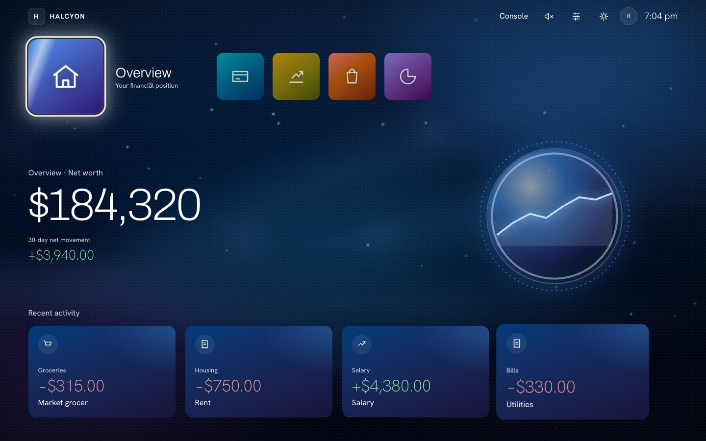

# Console Phase 3 · Dashboard device gate

| Reproduction field | Value |
| --- | --- |
| Branch | `codex/console-phase-3` |
| Application commit | `bc3d1d4dc5d87eaa313dfd116187a91df724039c` |
| Worktree | `/Users/joel/Developer/fin-app` |
| URL | [http://127.0.0.1:5320/dashboard](http://127.0.0.1:5320/dashboard) |

```sh
cd /Users/joel/Developer/fin-app/app
CHOKIDAR_USEPOLLING=1 npm run dev -- --host 127.0.0.1 --port 5320 --strictPort --force
```



Sign in and select **Console** if Classic is visible. Open **Overview**. On touch, tap the tile once to preview and again to open. On desktop, one click or Enter on the focused tile opens it. Use **Home** or Escape to return. The captures use the real entry and routes with fictional replies at the Auth and report API boundary.

| State | 1440 × 900 | 390 × 844 | 320 × 690 |
| --- | --- | --- | --- |
| Home · Overview | [Desktop](captures/console-phase-3/1440-home-overview.jpg) | [Phone](captures/console-phase-3/390-home-overview.jpg) | [Narrow phone](captures/console-phase-3/320-home-overview.jpg) |
| Overview hub | [Desktop](captures/console-phase-3/1440-overview-hub.jpg) | [Phone](captures/console-phase-3/390-overview-hub.jpg) | [Narrow phone](captures/console-phase-3/320-overview-hub.jpg) |

## Dashboard hardening

- Separate routed Home and Overview components share the Console viewport's warm Dashboard reports. Rapid Home previews issue no additional report requests. Overview's date and account controls scope Spending insights.
- At phone widths the trend orb shares the 30-day movement row. The headline spans the full row above. Both Home and Overview keep the headline, secondary figure and art boxes clear at 320px and 390px.
- Report failures offer retry. Empty results keep the module and its available actions. Balance redaction masks Dashboard amounts in text, screen-reader content and chart geometry. To view or edit transaction splits, show balances again in Settings.
- Dashboard activity opens the full parent transaction. A category correction refreshes the activity while the editor stays open. On close, keyboard focus returns to the corresponding activity row.

## Verification

| Check | Result |
| --- | --- |
| Console Playwright, axe and Classic smoke | 41 passed. The phone-only geometry case is skipped on the desktop project. Axe found zero violations in the tested Home, Income and Overview states. |
| Warm return and hero layout | Zero measured layout shift and zero hero-text overlaps during warm return. The cold placeholder and loaded headline preserve the same top position in the fixture. |
| Local Chrome navigation trace at 1440 × 900 | 13.43 ms longest renderer main-thread task in the marked 3.22 s sequence. Zero tasks over 50 ms and zero raw layout-shift events in that sequence. |
| Frontend and browser TypeScript, offline tests and production build | Passed. 731 offline tests. Vite reported its chunk-size advisory. |
| Physical M1 MacBook Air and Pixel 6a | Pending Joel's runs. |

[Local Chrome trace](traces/console-phase-3-chrome.json.gz) · [Physical-device recording script and results template](console-phase-3-device-gate.md)

The physical-device traces determine the Phase 3 verdict. The local Chrome recording covers warm Home → Overview, Overview collapse, Back and rapid Home previews. Use the Phase 3 device script for the matched effects-tier comparison.
