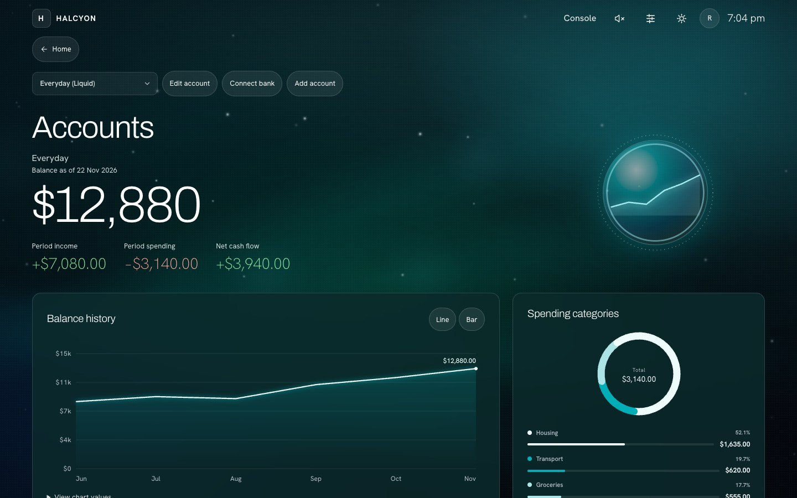

# Console Gate 4A · Analysis hubs

| Reproduction field | Value |
| --- | --- |
| Branch | `codex/console-phase-4a` |
| Application commit | `df244225038176272710691d4e5bccdc45855d8b` |
| Main base | `9f9b6ddbb06b2ca21b7dff889048c3fccef25338` |
| Worktree | `/Users/joel/Developer/fin-app` |
| URL | [http://127.0.0.1:5320/dashboard](http://127.0.0.1:5320/dashboard) |

```sh
cd /Users/joel/Developer/fin-app/app
CHOKIDAR_USEPOLLING=1 npm run dev -- --host 127.0.0.1 --port 5320 --strictPort --force
```



Sign in and select **Console** if Classic is visible. Enter each hub from the section row and scroll the hub to compact its header. **Home** returns focus to the originating tile. Captures and the recording use these signed-in routes. Fictional replies enter through the Auth and reporting API boundary.

| Hub | 1440 × 900 expanded | 1440 × 900 compact | 390 × 844 expanded | 390 × 844 compact |
| --- | --- | --- | --- | --- |
| Accounts | [Expanded](captures/console-phase-4a/1440-accounts-expanded.jpg) | [Compact](captures/console-phase-4a/1440-accounts-compact.jpg) | [Expanded](captures/console-phase-4a/390-accounts-expanded.jpg) | [Compact](captures/console-phase-4a/390-accounts-compact.jpg) |
| Income | [Expanded](captures/console-phase-4a/1440-income-expanded.jpg) | [Compact](captures/console-phase-4a/1440-income-compact.jpg) | [Expanded](captures/console-phase-4a/390-income-expanded.jpg) | [Compact](captures/console-phase-4a/390-income-compact.jpg) |
| Expenses | [Expanded](captures/console-phase-4a/1440-expenses-expanded.jpg) | [Compact](captures/console-phase-4a/1440-expenses-compact.jpg) | [Expanded](captures/console-phase-4a/390-expenses-expanded.jpg) | [Compact](captures/console-phase-4a/390-expenses-compact.jpg) |

[Home → Accounts → Income → Expenses walkthrough](captures/console-phase-4a/walkthrough.webm)

- Accounts gives the selected account its own balance hero, history chart, category distribution and opaque activity surface. Its existing add, edit and connect dialogs restore focus to the opener. A Home account card opens the corresponding account.
- On phone widths, Income puts one set of date and account filters below the hero. The compact header retains Home and the analyzer/projections tabs. Accounts and Expenses use that same responsive filter placement.
- Expenses uses the existing gross-outflow report in its hero, keeps the recurring entry and category comparisons, and exposes a keyboard period selector and exact chart values.

## Checks

The full browser suite passed 53 cases with one desktop skip for a phone-only check. After the final styling and Escape fix, the focused rerun passed all 14 cases. It includes axe in the expanded and compact states at both viewports, Classic smoke, account dialog focus, and an Expenses filter dismissal and recurring-tab round trip. Axe reported zero violations in the sampled hub states.

Frontend and browser TypeScript, 731 offline tests and the production build passed. The build reported Vite’s chunk-size advisory.

## 4× CPU phone proxy

Chrome with a 390×844 touch viewport and 4× CPU throttling. Two matching five-second idle windows cover Balanced and Reduce effects. The table subtracts Reduce from each corresponding Balanced statistic. Work is estimated in 16.67 ms bins from top-level tasks on Chrome’s renderer main, compositor, Viz and GPU threads. The estimator uses thread duration where available and task wall time on lanes that omit it. Navigation reports the longest renderer main-thread task in the marked sequence.

| Build | Added mean | Added p95 | Longest navigation task |
| --- | ---: | ---: | ---: |
| Phase 3 baseline | 2.42 ms | 3.58 ms | 136.80 ms |
| Gate 4A | 2.67 ms | 4.46 ms | 137.80 ms |

[Gate 4A Chrome proxy trace](traces/console-phase-4a-phone-proxy.json.gz) · [Phase 3 baseline trace](traces/console-phase-3-phone-proxy.json.gz)

The 4× proxy exceeded the 2 ms mean, 3 ms p95 and 50 ms navigation references. Mobile performance remains unmeasured on hardware. Halcyon’s physical gate is the owner’s Safari visual and interaction check on the 2020 M1 MacBook Air.

To repeat the proxy on the app already running on port 5320, run from `app/`:

```sh
node --experimental-strip-types e2e/console-phone-proxy.mjs /private/tmp/console-phone-proxy.json.gz
```

Gate 4A is ready for review before merge.
