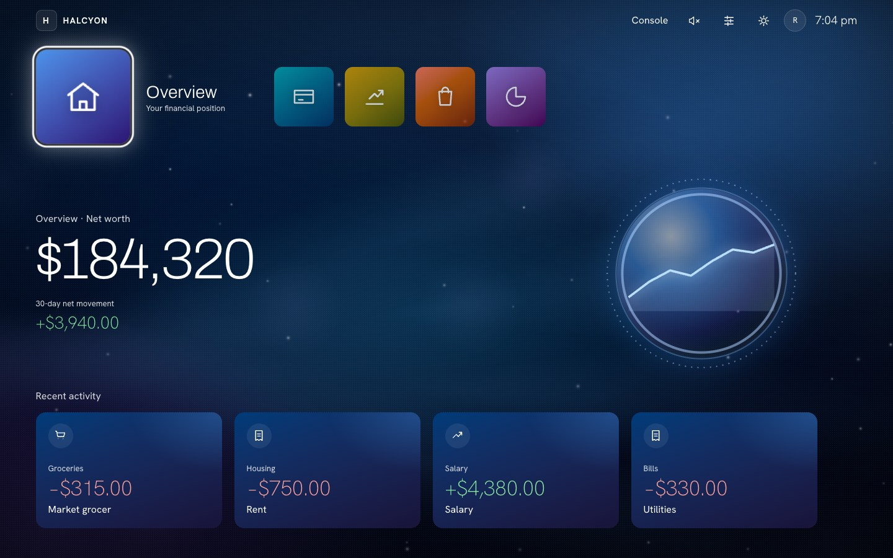

# Console Phase 4B-design review

| Reproduction field | Value |
| --- | --- |
| Branch | `codex/console-phase-4b-design` |
| Captured application commit | `c55bed5924f7f6b56ad701c57028e4f1dcd04e59` |
| Worktree | `/Users/joel/Developer/fin-app` |
| Signed-in entry | [http://127.0.0.1:5320/dashboard](http://127.0.0.1:5320/dashboard) |

```sh
cd /Users/joel/Developer/fin-app/app
CHOKIDAR_USEPOLLING=1 VITE_BUDGET_V1_ENABLED=true npm run dev -- --host 127.0.0.1 --port 5320 --strictPort --force
```



Sign in and select **Console** on Dashboard. Open Budget from its tile. Open Ledger review, Ingestion and Transfers from Control Centre. The captures and walkthroughs use the same signed-in entry and application routes, with fictional data supplied to the app's existing API calls.

## Captures and walkthroughs

| Hub | 1440×900 landing | 1440×900 mid-task | 390×844 landing | 390×844 mid-task | Walkthrough |
| --- | --- | --- | --- | --- | --- |
| Budget | [Landing](captures/console-phase-4b-design/1440-budget.jpg) | [Allocation review](captures/console-phase-4b-design/1440-budget-review.jpg) | [Landing](captures/console-phase-4b-design/390-budget.jpg) | [Allocation review](captures/console-phase-4b-design/390-budget-review.jpg) | [Change, review and save an allocation](captures/console-phase-4b-design/workflow-budget.webm) |
| Ledger | [Landing](captures/console-phase-4b-design/1440-ledger.jpg) | [Category correction](captures/console-phase-4b-design/1440-ledger-edit.jpg) | [Landing](captures/console-phase-4b-design/390-ledger.jpg) | [Category correction](captures/console-phase-4b-design/390-ledger-edit.jpg) | [Correct a category and return focus](captures/console-phase-4b-design/workflow-ledger.webm) |
| Ingestion | [Landing](captures/console-phase-4b-design/1440-ingestion.jpg) | [Statement staged](captures/console-phase-4b-design/1440-ingestion-staged.jpg) | [Landing](captures/console-phase-4b-design/390-ingestion.jpg) | [Statement staged](captures/console-phase-4b-design/390-ingestion-staged.jpg) | [Stage a statement and retain it on cancelled departure](captures/console-phase-4b-design/workflow-ingestion.webm) |
| Transfers | [Landing](captures/console-phase-4b-design/1440-transfers.jpg) | [Group expanded](captures/console-phase-4b-design/1440-transfers-review.jpg) | [Landing](captures/console-phase-4b-design/390-transfers.jpg) | [Group expanded](captures/console-phase-4b-design/390-transfers-review.jpg) | [Review and confirm one group](captures/console-phase-4b-design/workflow-transfers.webm) |

The Transfers scan action remains available when the internal queue is clear. [All reconciled at 1440×900](captures/console-phase-4b-design/1440-transfers-confirmed.jpg) · [All reconciled at 390×844](captures/console-phase-4b-design/390-transfers-confirmed.jpg).

## What changed

- The compact dock uses the Home pill, route title and status from the current workflow. A Budget tile entry projects the Home label and amount into the dock. A first visit resolves the amount from the Budget report when a current-period preview is unavailable. Console route loads bypass the Classic boot screen and use skeletons while waiting for data.
- Budget separates period navigation, everyday spending and progress, attention, allocation editing and funding summary. The allocation input shows currency on blur and exposes an editable decimal amount on focus. Save, discard and recovery use the existing paths.
- Ledger has an opaque transaction surface with Console column headings, filters and badges. Review counts, scope and classification rules sit in companion modules. The existing keyboard-operable transaction rows open the styled Console sheet and regain focus when it closes.
- Ingestion displays the account, upload, review and import steps. Its dock follows the uploader's true readiness and staged-row count. The review table is opaque and scrolls horizontally inside its module on phones.
- Transfers pairs the queue with decision guidance. After the internal queue clears, the ring and scan action take its place. The recorded group confirmation exercised the existing confirm and cancel paths. Native confirmation prompts are outside the browser video, and the test checks each response.

## Pre-merge triage

Batch 4B merged at `09257d0367d5439f5bfa5cabe9a96e9baf361773`. Classic is the default on main.

- The signed-in bulk preview posted two selected IDs and returned HTTP 200. Both bank classifications were protected, so the dialog kept Apply disabled. The fixture had incorrectly treated those rows as eligible. With eligible rows and a deterministic suggestion response, the live Apply returned HTTP 200, saved one change and offered Undo. The isolated service had no AI provider, so its fresh-suggestion call returned HTTP 400. A separate defect let a review resume after a drawer save with a stale preview. The dedicated main fix merged before 4B. [Ledger PR](https://github.com/jdomingo117/fin-app/pull/7) · [Batch 4B PR](https://github.com/jdomingo117/fin-app/pull/6)
- Classic assisted history shared its owner rate limit with direct fixture requests. The full isolated release paced both through the same queue, received HTTP 200 for assisted history and passed 598 checks before merge. [Pre-merge triage](console-phase-4b-triage.md)
- The earlier audit had compared DOM text while CSS uppercased `Item` and `Planned`. It now inspects computed text transformation, font caps and generated labels. The desktop Budget repair made both headings sentence case in Console.

## Verification

| Check | Result |
| --- | --- |
| Console workflow Playwright | 18/18 across both widths on the captured revision. |
| Console workflow axe | All eight landing scans passed. |
| Analysis Playwright and axe | 16/16 across both widths, including the rendered-casing regression. |
| Classic smoke | Passed at both widths for rendering, navigation and runtime errors. |
| Budget isolated release | 598/598 on the paced disposable backend. Classic assisted history returned HTTP 200. |
| Ledger isolated review | 15/15 contract checks and 4/4 browser cases. |
| Isolated import and transfer candidate | 8/8, including the 203-link batch. The disposable backend used provider-disabled mode. |
| Unit tests, types and build | 731/731 unit tests, application and browser type checks, and production build passed. |

| Rendered audit | States | Casing | Title token | Classic accent | Control variant | Date format |
| --- | ---: | ---: | ---: | ---: | ---: | ---: |
| 4A Accounts, Income and Expenses expanded and compact | 12 | 0 | 0 | 0 | 0 | 0 |
| 4B-design landings and four mid-task states | 16 | 0 | 0 | 0 | 0 | 0 |

[Rendered audit output, including counts per state](captures/console-phase-4b-design/rendered-audit.json).

At 390×844 with 4× Chrome CPU throttle, Balanced added **1.91 ms mean / 2.43 ms p95** per frame versus Reduce effects. The longest navigation task was **108.15 ms** across Budget, Ledger, Ingestion and Transfers. The preceding Gate 4B run measured 2.49 ms added mean, 3.67 ms added p95 and 142.31 ms for the same route sequence. These are software-proxy results. [Chrome trace](traces/console-phase-4b-design-phone-proxy.json.gz)

The design branch stops here for review before Phase 4C.
