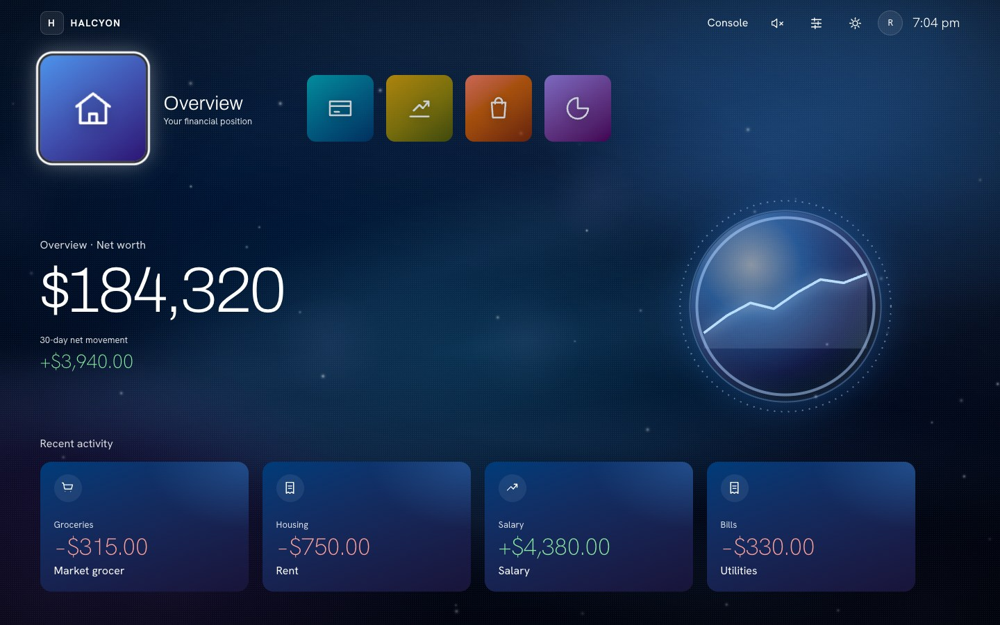

# Console Gate 4B · Workflow hubs

| Reproduction field | Value |
| --- | --- |
| Branch | `codex/console-phase-4b` |
| Application commit | `f817b8f26b4e5b328f952a71ec58bd1a27c19c2e` |
| Initial capture commit for Ledger, Ingestion and Transfers | `4fea2af050a215ca5e14b7a1439349c6ecb4eb95` |
| Main base | `8569c1dcb4c9c15ca6f90f86129ae1d30293b14e` |
| Worktree | `/Users/joel/Developer/fin-app` |
| URL | [http://127.0.0.1:5320/dashboard](http://127.0.0.1:5320/dashboard) |

```sh
cd /Users/joel/Developer/fin-app/app
CHOKIDAR_USEPOLLING=1 VITE_BUDGET_V1_ENABLED=true npm run dev -- --host 127.0.0.1 --port 5320 --strictPort --force
```



Sign in, select **Console** in the top bar, then enter Budget from the section row. Open Ledger review, Ingestion and Transfers from **Control Centre**. The captures and recordings start from the same signed-in application and use fictional responses supplied at the API boundary. [Phone Home capture](captures/console-phase-4b/390-dashboard.jpg)

## Captures and walkthroughs

| Workflow | 1440 × 900 | 390 × 844 | Desktop walkthrough and DevTools trace |
| --- | --- | --- | --- |
| Budget | [Hub](captures/console-phase-4b/1440-budget.jpg) · [Plan review](captures/console-phase-4b/1440-budget-review.jpg) · [Saved](captures/console-phase-4b/1440-budget-saved.jpg) | [Hub](captures/console-phase-4b/390-budget.jpg) · [Plan review](captures/console-phase-4b/390-budget-review.jpg) · [Saved](captures/console-phase-4b/390-budget-saved.jpg) | [Change an allocation and reopen the saved plan](captures/console-phase-4b/workflow-budget.webm) · [Trace](traces/console-phase-4b-budget-chrome.json.gz) |
| Ledger | [Hub](captures/console-phase-4b/1440-ledger.jpg) · [Correction](captures/console-phase-4b/1440-ledger-edit.jpg) · [Saved](captures/console-phase-4b/1440-ledger-corrected.jpg) | [Hub](captures/console-phase-4b/390-ledger.jpg) · [Correction](captures/console-phase-4b/390-ledger-edit.jpg) · [Saved](captures/console-phase-4b/390-ledger-corrected.jpg) | [Change a transaction category and restore row focus](captures/console-phase-4b/workflow-ledger.webm) · [Trace](traces/console-phase-4b-ledger-chrome.json.gz) |
| Ingestion | [Hub](captures/console-phase-4b/1440-ingestion.jpg) · [Staged rows](captures/console-phase-4b/1440-ingestion-staged.jpg) | [Hub](captures/console-phase-4b/390-ingestion.jpg) · [Staged rows](captures/console-phase-4b/390-ingestion-staged.jpg) | [Stage a statement and retain the draft after a cancelled exit](captures/console-phase-4b/workflow-ingestion.webm) · [Trace](traces/console-phase-4b-ingestion-chrome.json.gz) |
| Transfers | [Hub](captures/console-phase-4b/1440-transfers.jpg) · [Confirmed](captures/console-phase-4b/1440-transfers-confirmed.jpg) | [Hub](captures/console-phase-4b/390-transfers.jpg) · [Confirmed](captures/console-phase-4b/390-transfers-confirmed.jpg) | [Cancel and then confirm the selected group](captures/console-phase-4b/workflow-transfers.webm) · [Trace](traces/console-phase-4b-transfers-chrome.json.gz) |

Chrome's browser-native confirmations appear as pauses in the page recordings. Playwright verifies the prompt and the effects of cancelling or accepting. The Ingestion walkthrough ends with the rows staged and zero import writes.

## Workflow checks

- Budget keeps the existing review and save flow. Cancelling an exit preserves the amount being edited. Accepting discard returns to the last saved amount on the next in-app visit. A committed allocation whose response gets lost can be recovered after reload through the original operation lookup. The browser test verifies one write and one read of the matching receipt.
- Ledger accepts Arrow Up, Arrow Down, Home and End between transaction rows. Tab still reaches filters, checkboxes and the drawer. Cancelling Escape preserves a dirty correction. Saving sends the existing parent transaction ID and restores the opener on close. Typing C into the search field leaves the shortcut inactive.
- Ingestion focuses the staged-row heading and guards leaving while a statement is being prepared. Cancelling the exit keeps the staged rows and target account. The personal database was outside every test target.
- Transfers confirms the group and explains how the verdict affects Income and Spending. Cancelling sends zero writes. Confirming sends exactly one batch through the existing decision function.

## Classic leftovers

Before implementation, the audit flagged the uppercased Budget income-plan label and four Transfers action labels on both viewports. Ledger also flagged fixture merchants embedded in record-supplied labels. The revised source identifies those labels as record text for the casing check. Ingestion's idle state was clear on both viewports.

| Final sampled state | Viewports | Casing | Title token | Accent | Control variant | Date |
| --- | --- | ---: | ---: | ---: | ---: | ---: |
| Budget overview and allocation review | 1440, 390 | 0 | 0 | 0 | 0 | 0 |
| Ledger and correction drawer | 1440, 390 | 0 | 0 | 0 | 0 | 0 |
| Ingestion and staged statement | 1440, 390 | 0 | 0 | 0 | 0 | 0 |
| Transfers review queue | 1440, 390 | 0 | 0 | 0 | 0 | 0 |

The auditor attaches its checks and findings as JSON in each Playwright result. Gate 4C and Phase 5 use the same rendered audit.

## Test results

| Check | Result |
| --- | --- |
| Console workflow Playwright at 1440 × 900 and 390 × 844 | 18 passed, plus four passes when the Budget landing and save/discard workflow were rerun against the final application commit. All hub landing scans reported zero axe violations. |
| Offline tests, frontend and browser TypeScript, production build | 731 unit and contract tests passed. Both type checks and the build passed. |
| Existing Budget plan suite on isolated Supabase | 133 durable-boundary checks passed, including period-only save, period-and-future recovery and no console errors. |
| Existing full Budget release run | 479 checks passed before the Classic assisted account-history browser flow timed out. A targeted run from merged main reached the same history-coverage suite and later stopped on a 429. The full release run remains incomplete. |
| Existing Ingestion and Transfers suite on isolated Supabase | 8 passed, including actual imports and the 203-link transfer batch. The provider-disabled run excludes live AI categorisation. |
| Existing Ledger sessions and review contract | 7 session tests and 15 isolated contract checks passed. The live bulk browser suite passed its first case, failed on “Review selected (2)” and skipped its two later serial cases. The same scenario also fails on merged main with the stable rail locator, at its immediate request assertion after Apply. The full legacy browser suite remains incomplete. |
| Classic smoke and full Console suite | Classic smoke passed on Desktop and Phone. [Full Console CI for the initial capture commit](https://github.com/jdomingo117/fin-app/actions/runs/45117840701). |

## Performance

| Balanced proxy at 390 × 844, Chrome at 4× CPU throttle | Ambient-added mean | Ambient-added p95 | Longest navigation task |
| --- | ---: | ---: | ---: |
| Corrected 4A comparison | 2.42 ms | 3.26 ms | 141.79 ms |
| 4B, same Accounts → Income → Expenses route sequence | 2.30 ms | 2.97 ms | 135.77 ms |
| 4B, Budget → Ledger → Ingestion → Transfers | 2.49 ms | 3.67 ms | 142.31 ms |

The proxy subtracts the matched Reduce-effects Home sample from the Balanced Home sample. Chrome supplies wall-clock durations where thread CPU durations are missing. The navigation column reports the longest main-thread task in each route sequence. This is a desktop-hosted proxy for the phone layout. [Matched phone trace](traces/console-phase-4b-phone-proxy.json.gz) · [Workflow phone trace](traces/console-phase-4b-workflow-phone-proxy.json.gz)

```sh
cd /Users/joel/Developer/fin-app/app
node --experimental-strip-types e2e/console-phone-proxy.mjs ../docs/design/traces/console-phase-4b-phone-proxy.json.gz
node --experimental-strip-types e2e/console-phone-proxy.mjs ../docs/design/traces/console-phase-4b-workflow-phone-proxy.json.gz Budget 'Ledger review' Ingestion Transfers
```
