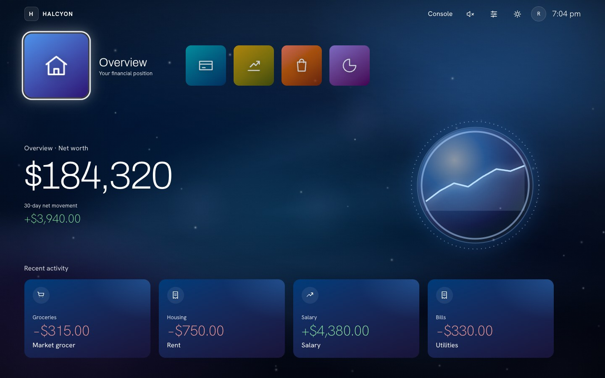

# Gate 4B pre-merge triage

| Reproduction field | Value |
| --- | --- |
| Branch reviewed | `codex/console-phase-4b` |
| Signed-in main reproduction | `8569c1dcb4c9c15ca6f90f86129ae1d30293b14e` |
| Worktree | `/Users/joel/Developer/fin-app` |
| Review URL | [http://127.0.0.1:5320/dashboard](http://127.0.0.1:5320/dashboard) |

```sh
cd /Users/joel/Developer/fin-app/app
CHOKIDAR_USEPOLLING=1 VITE_BUDGET_V1_ENABLED=true npm run dev -- --host 127.0.0.1 --port 5320 --strictPort --force
```



## Ledger

The signed-in main checkout used an isolated Supabase project. Two bank-classified rows opened the review dialog. Its real preview POST contained both IDs. The endpoint returned HTTP 200 with two protected rows and zero eligible rows. The UI displayed the protection reason and prevented applying a change. The old browser test marked those same bank rows eligible in its mock reply and asserted a submitted request before the async recheck had finished.

With two eligible fictional rows, Select all matching also carried both IDs into the real preview request. The provider-disabled isolated backend returned HTTP 400 for fresh suggestions. A deterministic preview response allowed the rest of the interaction to proceed. Choosing one category sent one real Apply POST with one assignment. The endpoint returned HTTP 200 with one updated row, and the dialog displayed “Applied 1 accepted change” with guarded undo.

The corrected fixture exposed a separate product defect on main. After editing a transaction from inside a preview, the resumed preview lacked the invalidation warning and still offered Apply. The dedicated main PR invalidates the preview after a successful edit. A read-only visit preserves the other staged choices. [Ledger fix PR](https://github.com/jdomingo117/fin-app/pull/7)

## Budget

The full Budget release finished with **598 passing checks** on a fresh disposable Supabase project. The isolated coverage browser and direct checks share the same 30-read-per-minute owner bucket. Pacing both to one request every 2.2 seconds prevented an unexpected 429. The browser asserted HTTP 200 for Classic assisted history and then verified the coverage UI. The remaining harness updates follow the current guided setup and goal copy and reopen the bill finder after refresh. Its review action is labelled with the source merchant, while the saved bill retains the user’s edited name.

## Rendered audit

The scanner now checks table headers, computed text transforms and font caps on the element holding each text node, and generated labels. Its regression probe exercises uppercase styling, small caps and an uppercase generated label. Before the CSS correction, the desktop Budget allocation review flagged `ITEM` and `PLANNED`. The mobile table showed its sentence-case generated labels. The production correction is limited to Console table headings.

| Signed-in states | Viewports | Casing | Title token | Accent | Control variant | House dates |
| --- | --- | ---: | ---: | ---: | ---: | ---: |
| Phase 4A Accounts, Income and Expenses, expanded and compact | 1440, 390 | 0 | 0 | 0 | 0 | 0 |
| Phase 4B workflow landings plus Budget review, Ledger drawer and Ingestion staging | 1440, 390 | 0 | 0 | 0 | 0 | 0 |

The retry passed 22 browser tests and logged 28 audited UI states. The workflow axe scans wait for both the route and its inner surfaces to settle.
