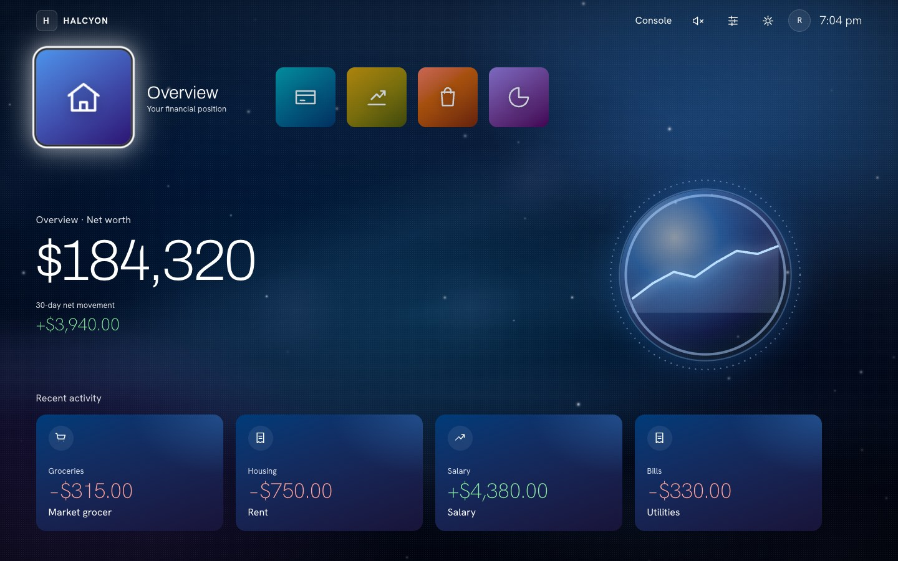

# Console Gate 4C · Settings and signed-in entry

| Reproduction field | Value |
| --- | --- |
| Branch | `codex/console-phase-4c` |
| Application commit | `1c3a946fa3cc93df7c54de926223182640b7101c` |
| Main base | `a0e98c8`, the approved 4B-design merge |
| Worktree | `/Users/joel/Developer/fin-app` |
| Signed-in entry | [http://127.0.0.1:5320/dashboard](http://127.0.0.1:5320/dashboard) |

```sh
cd /Users/joel/Developer/fin-app/app
CHOKIDAR_USEPOLLING=1 VITE_BUDGET_V1_ENABLED=true npm run dev -- --host 127.0.0.1 --port 5320 --strictPort --force
```



The port 5320 listener served Vite from this worktree’s `app/` directory. The captures use the rendered sign-in and signed-in routes, with fictional responses supplied at the app’s Auth and data API boundary. For Settings, select **Console** and open the gear beside Control Centre. Turn on **Show start screen** and load [the signed-in root](http://127.0.0.1:5320/) to reproduce Landing. The fresh appearance remains Classic. [Phone Dashboard capture](captures/console-phase-4c/390-dashboard.jpg).

## Captures and walkthroughs

| State | 1440 × 900 | 390 × 844 |
| --- | --- | --- |
| Settings | [Opening](captures/console-phase-4c/1440-settings.jpg) · [Changed preferences](captures/console-phase-4c/1440-settings-sound.jpg) | [Opening](captures/console-phase-4c/390-settings.jpg) · [Sound controls](captures/console-phase-4c/390-settings-sound.jpg) |
| Landing and Home | [Start prompt](captures/console-phase-4c/1440-start.jpg) · [Home after Enter](captures/console-phase-4c/1440-home-after-start.jpg) | [Start prompt](captures/console-phase-4c/390-start.jpg) · [Home after tap](captures/console-phase-4c/390-home-after-start.jpg) |
| Budget | [Unavailable estimate](captures/console-phase-4c/1440-budget.jpg) · [Allocation review](captures/console-phase-4c/1440-budget-review.jpg) | [Budget overview](captures/console-phase-4c/390-budget.jpg) · [Allocation review](captures/console-phase-4c/390-budget-review.jpg) |
| Ledger | [Counts and source details](captures/console-phase-4c/1440-ledger.jpg) · [Correction sheet](captures/console-phase-4c/1440-ledger-edit.jpg) | [Transactions](captures/console-phase-4c/390-ledger.jpg) · [Correction sheet](captures/console-phase-4c/390-ledger-edit.jpg) |
| Ingestion | [Account selector](captures/console-phase-4c/1440-ingestion.jpg) · [Staged row selectors](captures/console-phase-4c/1440-ingestion-staged.jpg) | [Account selector](captures/console-phase-4c/390-ingestion.jpg) · [Staged row selectors](captures/console-phase-4c/390-ingestion-staged.jpg) |
| Transfers | [Queue](captures/console-phase-4c/1440-transfers.jpg) · [Expanded group](captures/console-phase-4c/1440-transfers-review.jpg) · [Reconciled](captures/console-phase-4c/1440-transfers-confirmed.jpg) | [Stacked actions](captures/console-phase-4c/390-transfers.jpg) · [Expanded group](captures/console-phase-4c/390-transfers-review.jpg) · [Reconciled](captures/console-phase-4c/390-transfers-confirmed.jpg) |

Additional Settings widths are [320px](captures/console-phase-4c/320-settings.jpg), [768px](captures/console-phase-4c/768-settings.jpg) and [1024px](captures/console-phase-4c/1024-settings.jpg). The [200% layout proxy](captures/console-phase-4c/720-settings-200-percent.jpg) uses the 720×450 CSS viewport of a 1440×900 window at double zoom.

[Settings and appearance walkthrough](captures/console-phase-4c/settings.webm) · [Landing and direct entry walkthrough](captures/console-phase-4c/landing.webm)

## Data findings and behaviour

- **Ledger source.** The 4B-design Ledger reply built rows from reporting data that omitted `category_source`. This explains the all-Unknown capture. The production Ledger RPC selects the stored source. Manual edits, bank labels, automated suggestions and system seeds can populate it. Older or unclassified rows may have a null source. The gate sampled fictional data only and the prevalence of null sources in the personal Ledger remains unmeasured. The Console row now shows a known source in its secondary text and omits the standalone source column.
- **Ledger counts.** The old fixture ignored the requested review lens, returned every row as a match for the unresolved query and set attention to zero. The new fixture follows the production predicates and shows distinct values. The dock and the matching tab count uncategorised transactions with no recorded category source. **Needs attention** counts flagged or uncategorised transactions. **Can be recategorised** counts rows that satisfy the suggestion query. The counts cover the whole Ledger. The main activity module separately reports the result of the user’s current filters.
- **Budget forecast.** The 4B-design `query-budget` fixture omitted `details.forecast`, which directly triggers the missing-estimate message. Production forecasts can also be unavailable when there is insufficient verified history or incomplete account data. The unavailable module shows the actual reason and offers refresh when saved data needs checking. The report model and fixed-bill details are preserved.
- **Settings and Landing.** Appearance changes retain the route and pass through the existing draft guard. Effects tier, sound consent, mute, music, master volume, start prompt and shortcut use the existing preference owner. The start prompt runs on fresh signed-in Console Home entry when enabled. Home mounts after the dissolve and focuses Overview. A direct link to a hub opens that hub, and sign-out returns to login.

## Copy changes

| Hub | Before | After |
| --- | --- | --- |
| Ledger | `To review` (dock), `Unresolved` (module) | `Category not assigned` (dock, matching tab and module) |
| Ledger | `Needs attention` with a figure that changed with the active view | `Needs attention` with the Ledger-wide figure and the definition `Transactions flagged for review or marked uncategorised, including those above.` |
| Ledger | `Eligible for review` | `Can be recategorised` with a note on bank categories, manual choices and system balance adjustments |
| Ledger | `Source` column, `Unknown` when absent | `Category source: Bank` or another known source below the transaction name. Rows without a source omit the label. |
| Ledger | `Data scope` | `What’s shown` |
| Ledger | `Classification rules` / `Rules & review policy` | `Category rules` / `Manage category rules` |
| Ledger | `Review the rules and protections applied to transaction categories.` | `Choose when to flag categories for review and manage saved rules.` |
| Ingestion | `Create an account before importing — transactions have to belong to one.` | `Create an account to import its transactions.` |
| Ingestion | `Target locked while this file is being prepared. Cancel or finish the import to choose another account.` | `Finish or cancel this import to choose a different account.` |
| Ingestion | `Rows are matched against this account only; duplicate statements are detected and skipped.` | `Halcyon checks for duplicates in this account and skips any it finds.` |
| Ingestion | `N from saved rules/cache` / `N via AI` | `N from saved categories` / `N from new suggestions` |
| Ingestion | `Your bank used categories Halcyon has no direct equivalent for (…); those rows were sent to the AI instead.` | `Halcyon tried to suggest categories for rows with these bank categories: ….` |
| Ingestion | `Automated categorisation was unavailable for N merchants. Successful batches were kept; 1 row need review before importing.` | `Halcyon couldn’t suggest categories for N merchants. Available suggestions were kept. Review 1 row before importing.` |
| Transfers | `(N off-page)` | `(N on other pages)` when the selection includes rows on other pages |
| Transfers | `The safe batch limit is 200.` | `You can review up to 200 at a time.` |
| Transfers | `Count a payment or deposit as regular activity if it belongs in income or spending.` | `Choose “Count as regular activity” for payments or deposits that belong in income or spending.` |
| Budget | `Spending forecast unavailable. Refresh saved data to check the estimate.` | `Spending estimate unavailable` · `The saved budget didn’t include an estimate. Refresh to check again.` · `Refresh budget` |
| Budget | `The history behind these suggestions changed. Your edited amounts and goal are still here, but the old evidence cannot authorize a new draft.` | `The account history behind these suggestions changed. Review the suggestions again or save your amounts and goal as your own estimates.` |
| Budget | `Your source information changed, the suggestion method changed, or individual input review is missing. Recheck the suggestions, or explicitly keep these edited amounts as manual estimates before saving again.` | `These suggestions need another review before you can save. Review them again or keep the amounts as your own estimates.` |

## Rendered audit

| State set | States | Unstyled native selects before → after | Default accents before → after | Default outlines before → after |
| --- | ---: | ---: | ---: | ---: |
| 4A Accounts, Income and Expenses, expanded and compact | 12 | 0 → 0 | 0 → 0 | 12 → 0 |
| 4B Budget, Ledger, Ingestion and Transfers, landing and mid-task | 16 | 10 → 0 | 4 → 0 | 2 → 0 |
| 4C Settings opening and changed preferences, Landing prompt | 6 | — → 0 | — → 0 | — → 0 |

All sampled final states also passed casing, module-title, Classic-accent and date checks. The audit measures the computed variant and appearance of each select, the computed accent on native choice, range and progress controls, and the computed outline of the focused element. A regression test injects unstyled controls and verifies all three detections.

[Before and after rendered audit, with checks and findings for every state](captures/console-phase-4c/rendered-audit.json).

## Gate checks

| Check | Result |
| --- | --- |
| Console browser suite | 81 distinct cases passed across desktop and phone after targeted reruns. The desktop counterpart of the phone-only Overview test was skipped as configured. |
| Accessibility | Axe passed on the sampled Home, analysis and workflow hubs, Settings and Landing. Forced colours retained the Settings select focus outline. The 390px transfer test checked actual action button bounds. Settings passed the emulated 200% layout check. |
| Existing isolated Ledger review | 15 contract checks and four browser cases passed on a provider-disabled disposable Supabase stack. The harness verified an empty target before use and removed its resources. |
| Existing isolated import and transfer candidate | Eight cases passed on a separate provider-disabled disposable project, including the 203-link batch and real statement imports into fictional accounts. The runner removed the project resources. |
| Offline and production | 731 unit and contract tests passed. Application and browser types and the production build passed. Vite reported the existing chunk-size advisory. |

The first broad run exposed an ambiguous test locator after Settings gained its own appearance choices. The rerun used the Settings appearance group and verified cancellation and discard at both widths. Chrome also recorded an unexpected document reload during two phone checks on the preview listener carried over from 4B. Restarting Vite from the documented worktree resolved the redaction and volume reruns. The Settings axe assertion now samples after the Console entrance settles, matching the workflow hub check.

```sh
cd /Users/joel/Developer/fin-app/app
npx playwright test -c playwright.console.config.ts
CONSOLE_WORKFLOW_CAPTURE_DIR=../docs/design/captures/console-phase-4c npx playwright test -c playwright.console.config.ts console-settings-start console-workflows
```

Physical Safari interaction and phone hardware performance remain unmeasured for this batch. The recorded touch and 200% checks use Chrome emulation.

## Chrome phone proxy

Chrome ran at 390×844 with touch emulation and 4× CPU throttling. Balanced and Reduce effects each recorded 300 bins across matched idle windows on Home. The proxy subtracts each Reduce statistic from the corresponding Balanced statistic. It uses task CPU time where Chrome supplies it and task duration on the other lanes.

| Measurement | Result | Rollout target |
| --- | ---: | ---: |
| Ambient-added mean | 2.18 ms/frame | ≤2 ms/frame |
| Ambient-added p95 | 2.61 ms/frame | ≤3 ms/frame |
| Longest navigation task | 120.16 ms | ≤50 ms |
| Longest task after starting through Home entry | 34.34 ms | — |

The p95 fell within target. Mean ambient work and the longest navigation task exceeded their targets. The navigation segment exercised Budget, Ledger, Ingestion, Transfers, Settings and Control Centre. A separate segment recorded a tap on Start Halcyon and the entry to Home. [Chrome DevTools trace](traces/console-phase-4c-phone-proxy.json.gz).

```sh
cd /Users/joel/Developer/fin-app/app
node --experimental-strip-types e2e/console-phone-proxy.mjs ../docs/design/traces/console-phase-4c-phone-proxy.json.gz Budget 'Ledger review' Ingestion Transfers Settings Landing
```

Stop at Gate 4C for owner review. Phase 5 starts after approval.
