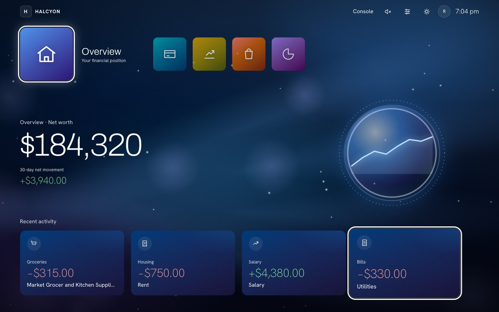

# Console Phase 5 · Cross-screen qualification

## Hold follow-up · 24 November 2026

| Reproduction field | Value |
| --- | --- |
| Branch | `codex/console-phase-5` |
| Application commit | `972d0ca0aae7e863bbe33e276eb402e5fc539b8b` |
| Worktree | `/Users/joel/Developer/fin-app` |
| Signed-in entry | [http://127.0.0.1:5320/dashboard](http://127.0.0.1:5320/dashboard) |

```sh
cd /Users/joel/Developer/fin-app/app
CHOKIDAR_USEPOLLING=1 VITE_BUDGET_V1_ENABLED=true npm run dev -- --host 127.0.0.1 --port 5320 --strictPort --force
```



The listener served the listed worktree’s `app/` directory. The tests signed in through Halcyon, selected Console and intercepted Auth, reports and workflow requests for the same fictional data. The Ledger fixture includes one uncategorised transaction with no category source, one uncategorised transaction with a recorded source and one separately flagged transaction.

### Affected acceptance checks

| Check | Result |
| --- | --- |
| 320×740, touch | Passed the signed-in matrix. Budget shows **Open to see this period** when no preview figure is available. [First tile](captures/console-phase-5-hold/320-home-first-tile.jpg) · [Budget tile](captures/console-phase-5-hold/320-home-last-tile.jpg) · [Ledger](captures/console-phase-5-hold/320-ledger-review.jpg). |
| 390×844, touch | Passed the signed-in matrix. **Search transactions** fits its own row. The long merchant remains available in the row’s accessible name and detail. [First tile](captures/console-phase-5-hold/390-home-first-tile.jpg) · [Budget tile](captures/console-phase-5-hold/390-home-last-tile.jpg) · [Ledger](captures/console-phase-5-hold/390-ledger-review.jpg). |
| 1440×900, keyboard | Passed the signed-in matrix, including Home focus and ring, route return and Control Centre. |
| Ledger | Desktop and phone passed the subset, count, category correction and focus-return checks. The dock, narrow tab and Review counts use **Never categorised** for the source-less subset (1). The broad tab and count use **All uncategorised** (2). **Needs attention** includes the separately flagged row (3). |
| Signed figures | Passed across all five sections, including the four ambient fade midpoints. The lowest measured figure-background ratio was **5.20:1**. Spending reached **6.00:1** at rest and at the fade midpoint. The Budget placeholder paint measured **5.52:1** at the midpoint when tested against the darker signed ink. [Pixel samples](captures/console-phase-5-hold/signed-figure-contrast.json). |
| Effects | Desktop and phone passed overlay suspension, the simulated visibility event, OS Reduce Motion, Reduce effects and their combination. Chrome automation kept the app visible during the real tab-switch attempt. The owner checklist covers that behaviour in Safari. |
| Rendered audit | 58 rendered states across the affected matrix and Ledger workflows recorded zero findings. [Computed audit](captures/console-phase-5-hold/rendered-audit.json). |

The activity radial highlight uses L .42, alpha .45 and a shorter vertical falloff. The card sweep is masked above the figure. The sampler pauses both ambient transitions at half their duration, waits for the foreground entrance to settle, and checks the brightest and darkest pixels under rendered glyphs. The glyph mask excludes blank font leading and neighbouring text from the original rectangular sample. The signed ink tokens retain their original values. [Activity paint specification](console-spec.md).

The 12 affected Playwright cases passed, including the desktop and phone visibility reruns. Four project-scoped copies were skipped as scheduled. Frontend and browser TypeScript checks, 731 offline tests and the production build passed. Vite reported its existing chunk-size advisory.

### Matched desktop traces

The original Gate 3 capture presented at 60 Hz. The initial Phase 5 foreground capture presented at 120 Hz and the harness still grouped tasks into 16.67 ms intervals. Recomputing that Phase 5 trace at its observed 8.33 ms interval gives **3.29 ms mean / 4.25 ms p95** added. This still exceeds the 2/3 ms limits.

The four comparisons below use Chrome 158.0.8127.37 on the same M3 Pro Mac, at 1440×900, 100% zoom and the display's 60 Hz mode. They share the same fixture, port, Overview and Income warmup, 40-point pointer path, matched five-second Full and Reduce windows, and 16.67 ms buckets. The display returned to 120 Hz after the run. Chrome task CPU time covers the renderer main thread, compositor, Viz and GPU service lanes. The summary records the lanes that used wall time for tasks without CPU duration. The table subtracts Reduce from Full for each statistic. The limits remain **≤2 ms mean**, **≤3 ms p95** and **≤50 ms for the longest renderer navigation task**.

| Application source | Longest navigation task | Ambient added mean / p95 | Result |
| --- | ---: | ---: | --- |
| Gate 3 `0ba234d` before | 14.98 ms | 3.95 / 4.26 ms | Hold · [Trace](traces/console-phase-5-hold-gate3-60-before.json.gz) |
| Gate 3 with the same ambient changes | 21.27 ms | 2.82 / 4.21 ms | Hold · [Trace](traces/console-phase-5-hold-gate3-60-after.json.gz) |
| Phase 5 `490e35b` before | 49.89 ms | 5.78 / 7.52 ms | Hold · [Trace](traces/console-phase-5-hold-phase5-60-before.json.gz) |
| Phase 5 `972d0ca` after | 30.59 ms | 2.82 / 4.19 ms | Hold · [Trace](traces/console-phase-5-hold-phase5-60-after.json.gz) |

The ambient component and scene CSS are byte-identical in `0ba234d` and `490e35b`. The canvas entered at `79073e5`, and `d92888a` capped its raster updates around 30 Hz before Gate 3. A threshold-based bisect needs a passing anchor. Both fresh baselines missed the budget, and repeated 120 Hz samples of the same Phase 5 source ranged from 4.26 to 7.51 ms added mean in the legacy buckets. The evidence establishes a cadence mismatch in the historical comparison and leaves the source of the remaining cost open.

The candidate paints particle halos into seven bands and animates their transforms and opacity. It groups the white light with the background parallax, uses a soft gradient for the beam, and settles the pointer after tracking stops. A trial with a separate CSS animation for each particle was more expensive. The paired candidate lowered the added mean on both source trees. Its 120 Hz run still reached **2.46 / 3.51 ms** per observed frame and **4.93 / 6.54 ms** in the legacy buckets. The same-route headless run reached **2.62 / 4.24 ms** in 60 Hz buckets. [120 Hz trace](traces/console-phase-5-hold-optimised-120.json.gz) · [Headless trace](traces/console-phase-5-hold-optimised-headless-shared.json.gz) · [Trace summaries and diagnostic runs](captures/console-phase-5-hold/performance.json).

The full 120 Hz foreground navigation replay covered the eight hubs, Settings, Control Centre, and start entry. Its longest renderer navigation task was **42.53 ms**. Ambient added work was **2.36 / 3.95 ms** at the observed cadence and **4.73 / 7.01 ms** in the reference buckets. [Full foreground trace](traces/console-phase-5-hold-desktop-headed.json.gz).

The 390×844 phone proxy replayed the same routes with 4× CPU throttling, a centred pointer, and Balanced versus Reduce effects. Its longest renderer navigation task was **56.90 ms**, below the 200 ms trend reference. Its added work was **0.93 / 1.76 ms** per reference interval. [Phone proxy trace](traces/console-phase-5-hold-phone.json.gz).

For the matched runs, `0ba234d`, `490e35b` and the patched Gate 3 tree came from isolated source exports. Each used the same dependencies and this listener command from its `app/` directory. The patched Gate 3 tree uses the candidate’s ambient component, ambient stylesheet, desktop aperture and viewport isolation changes. The Phase 5 after run used the worktree above on the same trace port.

```sh
VITE_SUPABASE_URL=http://127.0.0.1:54321 VITE_SUPABASE_ANON_KEY=fictional-console-ci-key \
  CHOKIDAR_USEPOLLING=1 VITE_BUDGET_V1_ENABLED=true \
  node /Users/joel/Developer/fin-app/app/node_modules/vite/bin/vite.js \
  --host 127.0.0.1 --port 5321 --strictPort --force

# Use the Phase 5 candidate's harness for all four runs.
CONSOLE_REVIEW_ORIGIN=http://127.0.0.1:5321 node --experimental-strip-types \
  e2e/console-phone-proxy.mjs /tmp/console-desktop.json.gz --desktop --headed Overview Income

# Use the review listener on port 5320 for the full route replays.
node --experimental-strip-types e2e/console-phone-proxy.mjs /tmp/console-foreground.json.gz \
  --desktop --headed Overview Accounts Income Expenses Budget 'Ledger review' Ingestion Transfers Settings Landing
node --experimental-strip-types e2e/console-phone-proxy.mjs /tmp/console-phone.json.gz \
  Overview Accounts Income Expenses Budget 'Ledger review' Ingestion Transfers Settings Landing
```

**Hold.** Desktop Full ambient work still exceeds the budget. The matched navigation, contrast, Ledger, and narrow capture checks passed. The review candidate is on `codex/console-phase-5`. GitHub `main` was pushed to the verified `jdomingo117/fin-app` origin at `366297a`, and its Console browser workflow passed. Safari sign-off remains required for the default switch. The approved observation is two weeks including a month-end cycle. [Green main CI](https://github.com/jdomingo117/fin-app/actions/runs/45363797205) · [Owner checklist](console-phase-5-owner-checklist.md) · [Rollout](console-rollout.md#phase-5-owner-review-and-rollout-decisions).

## Original qualification

| Reproduction field | Value |
| --- | --- |
| Branch | `codex/console-phase-5` |
| Application commit | `56b61bd6f486d11dfc865ee925dae4a3af827fa0` |
| Main base | `366297a`, approved Gate 4C merge |
| Worktree | `/Users/joel/Developer/fin-app` |
| Signed-in entry | [http://127.0.0.1:5320/dashboard](http://127.0.0.1:5320/dashboard) |

```sh
cd /Users/joel/Developer/fin-app/app
CHOKIDAR_USEPOLLING=1 VITE_BUDGET_V1_ENABLED=true npm run dev -- --host 127.0.0.1 --port 5320 --strictPort --force
```


The listener’s working directory was this worktree’s `app/` directory. The test signed in through Halcyon, verified the fresh Classic appearance, and selected Console. The fixture intercepts Auth and report calls and uses fictional figures, a long merchant name, a Ledger row with no category source and a Budget reply without an estimate. Workflow checks save to the fictional API fixture. The owner’s account is reserved for the [read-only Safari review](console-phase-5-owner-checklist.md).

## Acceptance matrix

| Condition | Evidence and result |
| --- | --- |
| 320×740, touch | [First tile](captures/console-phase-5/320px-matrix-all-signed-in-surfaces/home-first-tile.jpg) · [Last tile and its ring](captures/console-phase-5/320px-matrix-all-signed-in-surfaces/home-last-tile.jpg) · [Settings](captures/console-phase-5/320px-matrix-all-signed-in-surfaces/settings.jpg) |
| 390×844, touch | [Overview](captures/console-phase-5/390px-matrix-all-signed-in-surfaces/overview.jpg) · [Long merchant in Ledger](captures/console-phase-5/390px-matrix-all-signed-in-surfaces/ledger-review.jpg) · [Start](captures/console-phase-5/390px-matrix-all-signed-in-surfaces/start.jpg) |
| 768×900, touch | [Accounts](captures/console-phase-5/768px-matrix-all-signed-in-surfaces/accounts.jpg) · [Income compact](captures/console-phase-5/768px-matrix-all-signed-in-surfaces/income-compact.jpg) · [Ingestion](captures/console-phase-5/768px-matrix-all-signed-in-surfaces/ingestion.jpg) |
| 1024×900, keyboard | [Control Centre](captures/console-phase-5/1024px-matrix-all-signed-in-surfaces/control-centre.jpg) · [Expenses](captures/console-phase-5/1024px-matrix-all-signed-in-surfaces/expenses.jpg) · [Transfers](captures/console-phase-5/1024px-matrix-all-signed-in-surfaces/transfers.jpg) |
| 1440×900, keyboard | [Home first tile](captures/console-phase-5/1440px-matrix-all-signed-in-surfaces/home-first-tile.jpg) · [Home last tile](captures/console-phase-5/1440px-matrix-all-signed-in-surfaces/home-last-tile.jpg) · [Budget](captures/console-phase-5/1440px-matrix-all-signed-in-surfaces/budget.jpg) |
| Actual Chrome 200% zoom | A 1440px browser window produced a 720px CSS viewport at DPR 2. [Control Centre](captures/console-phase-5/200-percent-browser-zoom/control-centre.jpg) · [Settings](captures/console-phase-5/200-percent-browser-zoom/settings.jpg) |
| Forced colours | Desktop and 390px passed axe and the rendered focus audit after the system-colour repairs. Switch tracks and thumbs now distinguish checked and unchecked states. Home’s explicit plus and minus signs remain readable in the monochrome palette. [Settings](captures/console-phase-5/all-signed-in-surfaces-in-forced-colours/settings.jpg) · [Phone Ledger](captures/console-phase-5/phone-all-signed-in-surfaces-in-forced-colours/ledger-review.jpg). |
| Reduced motion | Desktop and 390px passed the surface matrix with OS Reduce Motion. Separate cases passed for OS reduction, Reduce effects, and both together. OS reduction froze the particle canvas. Reduce effects removed the canvas and decorative blur. Startup used a 150 ms fade. [Reduced Control Centre](captures/console-phase-5/all-signed-in-surfaces-with-os-reduced-motion/control-centre.jpg). |
| Classic fallback | Fresh Classic rendered and navigated without page errors at desktop and phone widths. Switching to Console persisted. |
| Effects, sound and workflow regressions | 83 existing Console Playwright cases passed with one scheduled Desktop skip for a phone-only check. The sound cases exercised fresh/off, opt-in, reload before a gesture, trusted startup, mute, music, 55%/15%/zero output, unavailable Web Audio, OS reduction and explicit audio override. The fictional workflow cases covered Budget save and recovery, Ledger correction and focus return, Ingestion staging, and transfer confirmation. |
| Signed figures | Open. The isolated composited gradients, including four sampled cross-fades, cleared 4.5:1 for both signed colours. The lightest sampled figure backgrounds in the complete scene fell below that threshold. Spending’s negative colour reached **2.83:1** in the resting sample. [Pixel samples](captures/console-phase-5/signed-figure-contrast.json). |

The width runs cover Home’s first and last tile, four expanded and compact analysis hubs, Budget, Ledger, Ingestion, Transfers, Settings, the open Control Centre and the settled start screen. Keyboard and touch runs operate Home and the overlay, enter every hub, return Home, and confirm focus after start. Each capture uses the same fictional data and records the live route state. The computed audit additionally checks casing, module-title tokens, Classic accents and controls, house dates, Australian spelling, and focus. The 4C follow-up recorded 38 rendered states and ten focused controls with zero findings. The final forced-colours reruns recorded 36 states and 36 focus checks with zero findings. Forced-colour mode permits the system’s native accent. [Audit output with before and after runs](captures/console-phase-5/rendered-audit.json).

The [supplied reference](../../prototypes/Home%20%E2%80%94%20console%20UI-html/Main.dc.html) anchors the first and last tile at the left with a rounded selected silhouette and a separate edge. The signed-in captures follow that geometry and adapt the label below the tile on narrow layouts. The track’s bounding box stayed fixed across the focus change. The application uses its own responsive report modules and the approved 4B/4C workflow surfaces. With no Budget preview figure, the Home tile, label and placeholder repeatedly say “Budget” in the 320px capture. Review that wording against the owner’s actual Budget state. At 390px the Ledger search placeholder clips before the word “merchant” completes. The long record name is available in the row’s accessible name.

For motion regression review, the Console CSS entrances and dwell transitions use opacity, transform and filter. The start-wordmark layers have fixed letter spacing and use visibility and opacity for their handoff. The crisp ring and glow shadows are static. The JavaScript projection animates x/y and scale against measured bounds. The canvas redraws ambient particles without updating document layout. Shared chart code remains on its existing adapter and Console chart paths use their final-state or transform presentation.

Application and browser TypeScript checks, 731 offline tests and the production build passed. Vite reported its existing chunk-size advisory.

## Performance

Chrome 157.0.8103.80 on macOS 26.6.2. Desktop was 1440×900 at 100% zoom with no CPU or network throttle. Each run warmed the route sequence before tracing. The active tier and Reduce effects used matched five-second samples. The desktop sample moved the pointer, and the phone sample kept it centred. Ambient metrics are the active tier minus Reduce effects, using task CPU time and wall time where Chrome supplied only duration. The longest navigation value is renderer main-thread wall time.

| Chrome run | Longest navigation task | Ambient added mean | Ambient added p95 | Result |
| --- | ---: | ---: | ---: | --- |
| Foreground desktop, Full | **16.63 ms** | **6.58 ms/frame** | **7.82 ms/frame** | Navigation met ≤50 ms. Ambient exceeded ≤2/3 ms. [DevTools trace](traces/console-phase-5-desktop-headed-chrome.json.gz). |
| Headless desktop cross-check, Full | 16.27 ms | 3.94 ms/frame | 5.47 ms/frame | Same outcome. The Full window drew about 60 frames per second. [DevTools trace](traces/console-phase-5-desktop-chrome.json.gz). |
| Phone proxy, 390×844 at 4× CPU, Balanced | **83.96 ms** | 2.70 ms/frame | 3.53 ms/frame | Below the 200 ms reference. Trend evidence. [DevTools trace](traces/console-phase-5-phone-proxy.json.gz). |

The foreground Full sample was 6.93 ms mean and 9.16 ms p95. Its Reduce baseline was 0.35 ms mean and 1.34 ms p95. [Trace summary data](captures/console-phase-5/performance.json). The traces include rapid focus, dwell, all eight hub routes and Settings, Home return, Control Centre and start entry. The headless cross-check and phone trace were recorded before the Phase 5 forced-colour paint changes, with normal effects active.

Chrome automation kept the app marked visible during the real tab-switch and minimise attempts, even with focus emulation disabled. In a separate test at the same signed-in route, a simulated document visibility event stopped the beam and particle frames. The count held at 51 while hidden and rose to 71 after restoring visibility. The real background-tab check remains in the Safari checklist. [Visibility readings](captures/console-phase-5/visibility.json) · [Browser tab trace](traces/console-phase-5-visibility-chrome.json.gz) · [Simulated visibility trace](traces/console-phase-5-visibility-fixture-chrome.json.gz).

```sh
cd /Users/joel/Developer/fin-app/app
CONSOLE_QUALIFICATION_CAPTURE_DIR=../docs/design/captures/console-phase-5 npx playwright test -c playwright.console.config.ts console-phase-five
node --experimental-strip-types e2e/console-phone-proxy.mjs ../docs/design/traces/console-phase-5-desktop-headed-chrome.json.gz --desktop --headed Overview Accounts Income Expenses Budget 'Ledger review' Ingestion Transfers Settings Landing
node --experimental-strip-types e2e/console-phone-proxy.mjs ../docs/design/traces/console-phase-5-phone-proxy.json.gz Overview Accounts Income Expenses Budget 'Ledger review' Ingestion Transfers Settings Landing
```

## Decision

**Hold at the Phase 5 gate.** Desktop navigation passed. Desktop Full ambient CPU and the sampled figure-background contrast missed the spec. The owner’s Safari review is pending. The automated results and owner review inform the approval decision for the default switch.

The original review left the Ledger labels open and prepared the [read-only Safari checklist](console-phase-5-owner-checklist.md). The hold follow-up above records the owner’s Ledger and rollout decisions.
