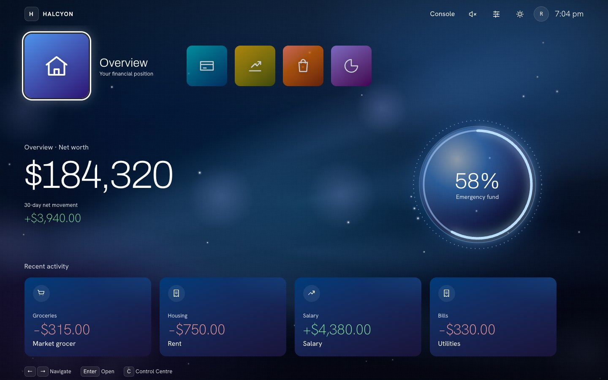

# Console Phase 6A · Home cards, ring and key hints

| Reproduction field | Value |
| --- | --- |
| Branch | `codex/console-phase-6a` |
| Application commit | `b4d2655858e03b967917b94e4494b8988e810f85` |
| Test commit | `39c0c9c52331a3c904860aef1575e45925903d89` |
| Main base | `9152de5`, the PR #13 merge |
| Worktree | `/Users/joel/Developer/fin-app` |
| Signed-in entry | [http://127.0.0.1:5320/dashboard](http://127.0.0.1:5320/dashboard) |

```sh
cd /Users/joel/Developer/fin-app/app
VITE_BUDGET_V1_ENABLED=true npm run dev -- --host 127.0.0.1 --port 5320 --strictPort
```



The 5320 listener served Vite from this worktree's `app/` directory. Before each run, I confirmed that the listener's working directory was this worktree and that it served `HomeCards.tsx`. Captures use the rendered sign-in and the signed-in Console default (`signInForConsole(..., 'fresh')`). The fixture supplies fictional replies at the app's Auth and data API boundary. No request reached a Supabase listener, and the default local database was not touched. To reproduce the goal ring, add a planning goal in the fixture, then choose it in **Settings › Appearance › Overview ring**.

## What changed

| Area | Behaviour | Source |
| --- | --- | --- |
| Budget preview | The spacer is replaced by up to four category-limit cards. Each card shows the amount spent of the amount allocated, in exact cents, with a bar. The categories closest to their limit come first. If there are more than four, a line says how many are shown. | `HomeCards.tsx`, `lib/consoleHome.ts` |
| Budget data | Home reads the workspace the Budget session has already loaded. Home never starts a Budget read. If this session hasn't opened Budget, the preview says so. The cold, loading, failed, no-plan, unsupported-method, other-period, no-limits, unavailable-details and refreshing states each have their own text. A missing usage figure reads **Unavailable**, has no bar and is never shown as `$0.00`. | `budgetHomeCards()` |
| Expenses preview | A **Top categories** card leads the activity row. It shows the three largest categories, with each one's amount and share of gross outflow. It uses the category facets in Home's existing cash-flow report, summed and ranked the same way as the Expenses hub. Selecting it opens the hub for the same 30-day window. | `topExpenseCategories()` |
| Overview ring | Settings can point the ring at one active planning goal. The choice is stored on the device as a Console preference. Progress uses the Strategic projections current value. The ring falls back to the net worth trend when no goal is chosen or the chosen one can't be measured. Planning goals are read only after a goal is chosen. The Overview hub keeps the trend art. | `goalRing()`, `ConsolePreferences.tsx` |
| Key hints | **← → Navigate · Enter Open · C Control Centre** shows with a fine pointer only. When the C shortcut is off, the last item reads **Control Centre shortcut off**. | `ConsoleKeyHints` |

No new write path, migration or Edge Function is involved. Money goes through `fmtCents()` via `consoleMoney()`. Shares and bar widths are ratios of integer cents.

## Decisions for the owner

1. **How to choose the ring's goal (open decision 3). Approved as built on 27 November 2026.** Nothing in Halcyon could nominate a goal, and Phase 6 allows no new write path. The ring therefore uses a per-device Console preference with **Net worth trend** as the default. Syncing the choice across devices would need a new write path and a fresh decision.
2. **Budget card order.** Cards are ranked by share spent, so the most pressing limits come first. Budget's own order would match the hub's table instead.
3. **Merging during observation.** If you approve, the merge goes in the [observation log](console-rollout.md#default-switch-observation) so that a regression can be traced to this batch.

## Captures

All states use fictional data. The 320 and 390 widths use the Phone project, with touch and a coarse pointer, so the key hints are hidden. The other widths use Desktop Chrome.

| State | 320 | 390 | 768 | 1024 | 1440 |
| --- | --- | --- | --- | --- | --- |
| Overview with goal ring | [320](captures/console-phase-6a/320-overview-goal.jpg) | [390](captures/console-phase-6a/390-overview-goal.jpg) | [768](captures/console-phase-6a/768-overview-goal.jpg) | [1024](captures/console-phase-6a/1024-overview-goal.jpg) | [1440](captures/console-phase-6a/1440-overview-goal.jpg) |
| Expenses with top categories | [320](captures/console-phase-6a/320-expenses.jpg) | [390](captures/console-phase-6a/390-expenses.jpg) | [768](captures/console-phase-6a/768-expenses.jpg) | [1024](captures/console-phase-6a/1024-expenses.jpg) | [1440](captures/console-phase-6a/1440-expenses.jpg) |
| Budget before Budget is opened | [320](captures/console-phase-6a/320-budget-cold.jpg) | — | [768](captures/console-phase-6a/768-budget-cold.jpg) | — | — |
| Budget category limits | [320](captures/console-phase-6a/320-budget-cards.jpg) | [390](captures/console-phase-6a/390-budget-cards.jpg) | [768](captures/console-phase-6a/768-budget-cards.jpg) | [1024](captures/console-phase-6a/1024-budget-cards.jpg) | [1440](captures/console-phase-6a/1440-budget-cards.jpg) |
| Settings, Overview ring | — | [390](captures/console-phase-6a/390-settings-overview-ring.jpg) | — | — | [1440](captures/console-phase-6a/1440-settings-overview-ring.jpg) |

The cold Budget state appears once per project, because loading Budget for the next widths warms the session. Its text is the same at every width. At 1024 × 768, Home already scrolls, and the key hints sit below the cards.

### Fixed during the gate

- At the phone ring size, a long goal name was cut to "Emergenc…". The caption now wraps to two lines inside the ring.
- At 390, the Settings option "Progress toward Emergency fund" was truncated. Options now show the goal name, under the **Overview ring** label.
- One 320 capture showed a card's hover ring because the pointer was still where the sign-in click left it. This came from the test harness, not the app. Captures now move the pointer away first.

## Tests

| Check | Result |
| --- | --- |
| `npx tsc --noEmit -p tsconfig.json`, unused declarations, budget foundation, workspace and concept configs | Pass |
| `npm run test:browser:typecheck` | Pass |
| `npm test` | 742 passed, including 8 new `lib/consoleHome.test.ts` cases |
| `npm run build` | Pass, with the existing chunk-size advisory |
| Console Playwright suite, Desktop and Phone, against the verified 5320 listener | 130 passed, 10 skipped by project or capture-only conditions, 0 failed |
| `console-phase-six.spec.ts` after adding the redaction regression | 16 passed (8 Desktop, 8 Phone) |
| WebKit | **Not run locally.** Only Chromium is installed, and I didn't download WebKit. The WebKit project now includes `console-phase-six.spec.ts`. CI run [45810991346](https://github.com/jdomingo117/fin-app/actions/runs/45810991346) on `563923b` passed all eight 6A regressions in WebKit; the capture-only test is skipped there by design. |

The new regressions cover the following:

- **Cold Budget preview.** It sends no `query-budget` request and shows its cold text.
- **Ranked limits.** The four limits appear in order, in exact cents, with bar widths and the "4 of 5" line.
- **Missing data.** Missing usage shows no `$0.00` and no bar. A plan without category limits shows its own text.
- **Expenses reconciliation.** The Expenses shares (Housing $1,635.00 · 52%, Transport $620.00 · 20%, Groceries $555.00 · 18%) are checked against the hub's $3,140 gross outflow and its category flow totals.
- **Goal ring.** The ring tracks the goal (58%, `58 100` dash) and keeps it after a reload. It returns to the trend, and makes no planning read before a goal is chosen. The Overview hub keeps the trend. A goal that's gone falls back to the trend, with an explanation in Settings.
- **Redaction.** No dollar figures, bars or goal progress are shown.
- **Key hints.** They're visible for a fine pointer and hidden for touch. ← → and Enter work as labelled. C opens Control Centre, and Escape closes it. Turning the shortcut off changes the label, and C then does nothing.

### Rendered leftover audit and axe

[Audit and axe output](captures/console-phase-6a/audit.txt). The leftover audit checked 13 states across Desktop and Phone: Budget cold, cards and redacted, Expenses categories, the Overview goal ring, the Settings ring control and Home key hints. Every issue list was empty: casing, module titles, accents, controls, default accents and outlines, FocusRing, control contrast, dates, spelling and unsigned colour. All 13 axe scans (WCAG 2.0/2.1 A and AA) reported no violations. The 130-test suite also reran the existing Phase 5 audits on this branch, with no findings.

I didn't run a separate start-of-batch audit on `main`. The Phase 5 matrix in the full suite covers the unchanged surfaces.

## Performance

Chrome 158.0.8127.37 ran headed at 1440 × 900 and 100% zoom, with no throttling, using the existing harness. The route sequence was Overview, Accounts, Income, Expenses, Budget, Ledger review, Ingestion, Transfers, Settings and Landing. **This Mac presented at 120 Hz** (display link median 8.33 ms). The Phase 5 limits were judged at 60 Hz after the display was switched, and I couldn't change the refresh rate here. So the table reports added cost at the observed cadence, and frame delivery within 1.25 × 8.33 ms. To separate 6A from the conditions, I ran `main` (`9152de5`) six times on the same machine, alternating with 6A for runs 4–6.

| Tree | Added mean (median) | Added p95 (median) | Idle frames on time (median) | Navigation frames on time (median) | Longest navigation task |
| --- | ---: | ---: | ---: | ---: | ---: |
| 6A, 6 runs | 3.43 ms | 4.53 ms | 86.02% | 93.92% | 18.68 ms median · 20.97 ms max |
| `main`, 6 runs | 2.85 ms | 3.84 ms | 84.92% | 94.62% | 18.36 ms median · 42.57 ms max |

| Run | 6A mean / p95 | `main` mean / p95 |
| --- | --- | --- |
| 1 | 3.46 / 4.45 | 2.23 / 3.17 |
| 2 | 3.52 / 5.75 | 2.32 / 2.98 |
| 3 | 3.55 / 5.17 | 3.54 / 4.75 |
| 4 | 3.37 / 4.49 | 3.37 / 4.60 |
| 5 | 3.40 / 4.56 | 2.26 / 2.89 |
| 6 | 2.21 / 2.66 | 3.38 / 4.50 |

**Reading.**

- **Navigation passes.** Every 6A run is under the ≤50 ms limit.
- **Ambient cost, two modes.** Both trees switch between the same two modes: about 2.2–2.3 ms added mean, or about 3.4–3.5 ms. Within each mode, 6A and `main` match to within 0.2 ms. The 6A medians are higher only because 6A landed in the slower mode in five of six runs, against three of six for `main`. The fast-mode runs also present fewer idle frames on time. That points to Chrome's frame production, not page work.
- **Against the Phase 5 limits.** At the observed 120 Hz cadence, the 6A median (3.43 / 4.53 ms) is over the 3 ms mean limit and within the 5 ms p95 limit. So is `main` in its slower mode.
- **Frame delivery.** Neither tree reaches 95% at 120 Hz. This needs a 60 Hz rerun on your display before the limits can be judged the way Phase 5 judged them.
- **Not caused by 6A.** The batch adds no animation, ambient work or layout transition. The new elements are static cards, bars and text.

[Representative 6A trace, run 2](traces/console-phase-6a-desktop-2.json.gz) · [All twelve run summaries, including the 16.67 ms bucket values](captures/console-phase-6a/performance.json).

```sh
cd /Users/joel/Developer/fin-app/app
node --experimental-strip-types e2e/console-phone-proxy.mjs ../docs/design/traces/console-phase-6a-desktop-2.json.gz \
  --desktop --headed Overview Accounts Income Expenses Budget 'Ledger review' Ingestion Transfers Settings Landing
```

For the baseline, run the same command from a `9152de5` worktree with `CONSOLE_REVIEW_ORIGIN=http://127.0.0.1:5321` and its own listener on 5321.

## Gate

**Stopped for owner review.** 6A isn't merged, and 6B hasn't started. To finish the gate:

- decisions 2 and 3 above (decision 1 is approved);
- a 60 Hz trace rerun, if you want the Phase 5 comparison on the same display mode.
