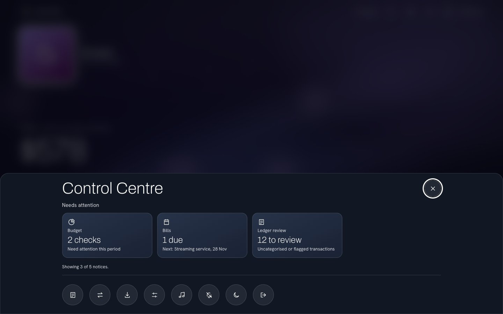

# Console Phase 6B · Control Centre notices and actions

| Reproduction field | Value |
| --- | --- |
| Branch | `codex/console-phase-6b` |
| Application commits | `999e945` (notice derivations), `cec8ba4` (Control Centre, Quiet alerts, Rest) |
| Test commit | `bef9c0b` |
| Error toasts through Quiet alerts | `76b1c76` (app), `be4c8f7` (test) |
| Main base | `b5487ff`, the PR #15 merge |
| Worktree | `/Users/joel/Developer/fin-app` |
| Signed-in entry | [http://127.0.0.1:5320/dashboard](http://127.0.0.1:5320/dashboard) |

```sh
cd /Users/joel/Developer/fin-app/app
VITE_BUDGET_V1_ENABLED=true npm run dev -- --host 127.0.0.1 --port 5320 --strictPort
```



Nothing was listening on 5320, so the suites ran with `CI=1` and started their own Vite listener from this worktree. Captures use the rendered sign-in and the signed-in Console default (`signInForConsole(..., 'fresh')`). The fixture supplies fictional replies at the app's Auth and data API boundary. No request reached a Supabase listener, and the default local database was not touched.

## What changed

| Area | Behaviour | Source |
| --- | --- | --- |
| Notices | The two fixed attention cards become a notice strip. It shows up to three notices in a fixed order: **Budget** checks, **Bills** due in the next 14 days, **Ledger review**, **Transfers**, then **Goals** at their target. If there are more, a line says how many are shown. | `ControlCentre.tsx`, `lib/consoleNotices.ts` |
| Budget notice | Uses the active check count from the Budget session's loaded workspace. Control Centre never starts a Budget read. Until Budget's current period has been opened this session, Budget isn't checked, and the strip says **Budget is checked once you open it.** If the current period is loaded but its checks are missing, Budget counts as a source that couldn't be checked. | `budgetSource()` |
| Bills notice | Active recurring series expected from today through the next 13 days. It shows the count and the soonest bill with its house date, such as **Next: Streaming service, 28 Nov**. It opens Expenses on the **Recurring hub** tab. | `billsDue()` |
| Ledger and Transfers | The existing portfolio counts. Ledger review covers uncategorised and flagged transactions, and opens Ledger on its needs-review list as before. | `portfolio_summary` |
| Goals notice | Active planning goals whose current value has reached the target, using the same value as Strategic projections. It opens Income on the **Strategic projections** tab. | `goalRing()` |
| Reads | Recurring bills and planning goals are read on the first open of Control Centre and kept for the session. Nothing new is read before then. | `useRecurrence`, `usePlanning` |
| Empty and incomplete | With no notices and nothing failed, the strip reads **All caught up**. An unopened Budget is named under it. If a source failed, the strip reads **Nothing to show** and names what couldn't be checked, so a failure is never reported as clear. While any source is loading, it reads **Checking for notices…** | `consoleNotices()`, `noticeGapText()` |
| Quiet alerts | A quick action, pressed or not. While it's on, routine Console toasts are dropped for this signed-in visit. Toasts that report a failure carry `tone: 'error'` and always show. It turns off on sign-out or reload, and doesn't affect Classic. | `App.tsx`, `useView().quietAlerts`, `MilestoneToast.tsx` |
| Rest | A quick action shown only while **Show start screen** is on. From Home it brings back the start screen. From a hub it goes Home first, through the normal Back path and its unsaved-changes guard. **Start Halcyon** returns Home with focus restored. | `ConsoleViewport.tsx` |
| Actions layout | Desktop keeps one row, now of seven or eight actions. Phones wrap to rows of four, with labels below. | `control-centre.css` |

**Add transaction** isn't added. Manual entry has no Edge Function path: `upsert-transactions` is only called by CSV ingestion. No new write path, migration or Edge Function is involved.

## Decisions for the owner

1. **Notice order. Settled on 27 November 2026: kept as built.** The plan asks for a fixed order without setting one. The order is: money already at risk (Budget), money about to leave (Bills), the review queues (Ledger, then Transfers), then good news (Goals). The plan's list order would have put Goals third.
2. **Goal milestones. Settled on 27 November 2026: target reached only.** Halcyon keeps no history of when a goal crossed 25%, 50% or 75%, so a crossing can't be detected honestly. So the notice fires only at **target reached**. Earlier milestones would need recorded progress.
3. **Quiet alerts and error toasts. Settled on 27 November 2026: errors get through.** Toasts had no severity, so the gate build dropped errors too: a failed callsign save in Settings reports only by toast. Toasts now take an optional `tone: 'error'`. The failure toasts in Settings, Account security, sign-out, sign-in and onboarding use it, and Quiet alerts never hides them.
4. **Merging during observation. Approved on 27 November 2026, once CI is green.** The merge goes in the [observation log](console-rollout.md#default-switch-observation).

## Captures

All states use fictional data. The 320 and 390 widths use the Phone project, with touch and a coarse pointer. The other widths use Desktop Chrome. The three-notice state turns on **Show start screen**, so Rest appears and the row has eight actions.

| State | 320 | 390 | 768 | 1024 | 1440 |
| --- | --- | --- | --- | --- | --- |
| No notices, Budget not opened | [320](captures/console-phase-6b/320-centre-zero.jpg) | [390](captures/console-phase-6b/390-centre-zero.jpg) | [768](captures/console-phase-6b/768-centre-zero.jpg) | [1024](captures/console-phase-6b/1024-centre-zero.jpg) | [1440](captures/console-phase-6b/1440-centre-zero.jpg) |
| One notice (goal reached) | [320](captures/console-phase-6b/320-centre-one.jpg) | [390](captures/console-phase-6b/390-centre-one.jpg) | [768](captures/console-phase-6b/768-centre-one.jpg) | [1024](captures/console-phase-6b/1024-centre-one.jpg) | [1440](captures/console-phase-6b/1440-centre-one.jpg) |
| Three of five notices, with Rest | [320](captures/console-phase-6b/320-centre-three.jpg) | [390](captures/console-phase-6b/390-centre-three.jpg) | [768](captures/console-phase-6b/768-centre-three.jpg) | [1024](captures/console-phase-6b/1024-centre-three.jpg) | [1440](captures/console-phase-6b/1440-centre-three.jpg) |

## Tests

| Check | Result |
| --- | --- |
| `npx tsc --noEmit -p tsconfig.json`, unused declarations, budget foundation, workspace and concept configs | Pass |
| `npm run test:browser:typecheck` | Pass |
| `npm test` | 748 passed, including 6 new `lib/consoleNotices.test.ts` cases |
| `npm run build` | Pass, with the existing chunk-size advisory |
| Full Console Playwright suite, Desktop and Phone, `CI=1`, three shards | 149 passed, 17 skipped by project or capture-only conditions, 0 failed |
| `console-phase-six-b.spec.ts` with captures | 23 passed, 1 skipped |
| After letting errors through Quiet alerts: types, browser types, `npm test` (748), build, the full Console suite (149 passed, 17 skipped, 0 failed) and `console-phase-six-b.spec.ts` (17 passed, 7 capture-only skips) | Pass |
| WebKit | **Not run locally.** Only Chromium is installed, and I didn't download WebKit. The WebKit project now includes `console-phase-six-b.spec.ts`, so CI runs the 6B regressions and the owner-fixes focus regression in WebKit. |

The new regressions cover the following:

- **Read discipline.** No planning or recurrence read before the first open, and no Budget read from Control Centre.
- **Two notices.** Ledger review and Transfers, with the unopened-Budget note. Ledger opens its needs-review list.
- **Three of five.** Budget, Bills and Ledger in order, with "Showing 3 of 5 notices." Bills opens Expenses on the Recurring hub tab; Budget opens Budget. This runs with touch taps on the Phone project.
- **One notice.** A reached goal opens Income on Strategic projections.
- **All caught up.** With and without Budget opened.
- **Failure.** A failed goals read reads "Nothing to show … Couldn’t check goals." rather than "All caught up".
- **Keyboard.** Shift+Tab from Close wraps to Sign out. Tab reaches the notices, arrows rove between them, Tab moves on to the quick actions, and Escape returns focus to the opener.
- **Quiet alerts.** Pressed state. A routine **Transaction updated** toast stays hidden while it's on, and a failed callsign save still shows, marked as an error. It turns off from the same action.
- **Rest.** Absent until **Show start screen** is on. Rest from Home and from a hub shows the start screen, and Start returns Home.

The existing gate-three Control Centre test now looks for the **Notices** group and waits for it before tabbing, since notices appear once their reads settle. The owner-fixes focus and Safari wrap regressions passed unchanged in Chromium.

### Rendered leftover audit and axe

[Audit and axe output](captures/console-phase-6b/audit.txt). The leftover audit checked 6 Control Centre states on Desktop and Phone: two notices, three notices, one notice, all caught up with and without Budget opened, and Quiet alerts on. Every issue list was empty. All 12 axe scans of the Control Centre (WCAG 2.0/2.1 A and AA) reported no violations.

## Found in passing

Every toast, error or not, shows a tick and the label **Milestone reached**. This was already the case before 6B and also affects Classic, so it isn't changed here. With `tone` in place, a later fix could give error toasts their own icon and label.

## Gate

**Stopped for owner review.** 6B isn't merged, and 6C hasn't started. To finish the gate:

- decision 4 above (decisions 1 to 3 are settled);
- the WebKit result from CI on the PR.

The first CI run on the PR failed one Desktop case, the Phase 5 `768px matrix`: an ArrowRight didn't select Expenses. The test doesn't open Control Centre, passed in both full local runs and passed five repeats locally. The same matrix test has failed intermittently in CI on earlier branches, at 320 and with reduced motion. It's treated as that known flake unless the rerun fails again.

The CI run on `6c5f401` passed that matrix test but failed two others:

- **6A Settings axe scan, Desktop.** Axe reported colour contrast on the active **Console** appearance chip. The chip has a colour transition, and the 6A scan didn't wait for the route's entry and transitions to finish, so axe measured a half-faded colour. The same scan passed in earlier runs. Both Phase 6 scan helpers now wait for finite animations and transitions before auditing.
- **WebKit, `console-owner-fixes` Expenses counts.** `page.goto` failed with "WebKit encountered an internal error" before the page loaded. That's a browser-level failure, not a test assertion.
