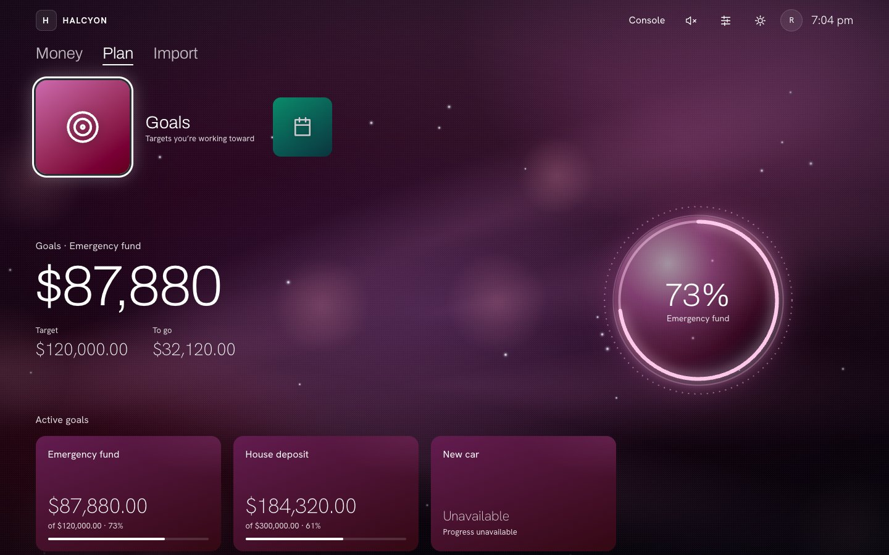

# Console Phase 6C · Money and Plan rows

| Reproduction field | Value |
| --- | --- |
| Branch | `codex/console-phase-6c` |
| Application commits | `315cff4` (shared Plan reads), `e675cc5` (rows, Goals and Bills hubs), `3942347` (goal and bill forms), `95c47f6` (compact dock label) |
| Test commits | `94360e8` (6C spec, Phase 5 matrix, renamed row toolbar), `f8d17d1` (walkthrough timing) |
| Main base | `a9293a2`, the PR #16 merge |
| Worktree | `/Users/joel/Developer/fin-app` |
| Signed-in entry | [http://127.0.0.1:5320/dashboard](http://127.0.0.1:5320/dashboard) |

```sh
cd /Users/joel/Developer/fin-app/app
VITE_BUDGET_V1_ENABLED=true npm run dev -- --host 127.0.0.1 --port 5320 --strictPort
```



The browser suites ran with `CI=1` and started their own Vite listener from this worktree. For captures and traces I ran the command above myself and confirmed that the listener's working directory was this worktree and that it served the Plan row. Captures use the rendered sign-in and the signed-in Console default (`signInForConsole(..., 'fresh')`). The fixture supplies fictional replies at the app's Auth and data API boundary. No request reached a Supabase listener, and the default local database was not touched.

## Owner decisions

Asked before any code, on 27 November 2026.

1. **Ledger, Transfers and Ingestion (open decision 1).** Ledger review and Transfers stay in Control Centre. **Ingestion gets its own Home row**, labelled **Import**, and keeps its Control Centre quick action too.
2. **Investments (open decision 2).** Stays inside Accounts. Money keeps Overview, Accounts, Income, Expenses and Budget.
3. **First Plan hubs (open decision 4).** Goals and Bills.

Decision 3 was already settled in 6A.

## What changed

| Area | Behaviour | Source |
| --- | --- | --- |
| Row tabs | A visible tab control above the tiles reads **Money · Plan · Import**. It's one tab stop. ← → move between rows and show each as they go, and Home and End jump to the first and last. The selected row is underlined. | `HomeRowTabs.tsx` |
| Rows | One row shows at a time, as in the prototype. Each row is its own toolbar (**Money sections**, **Plan sections**, **Import sections**) with its own roving tab stop, inside a tab panel named by its tab. Each row remembers its last tile, so switching back returns to it. | `sections.ts`, `ConsoleHome.tsx`, `ConsoleViewport.tsx` |
| Back and deep links | `/goals`, `/bills` and `/ingestion` open their hubs directly. Back returns to the hub's row with its tile focused. A hub opened from Control Centre returns to the tile Home last had, as before. | `ConsoleViewport.tsx` |
| Plan reads | One provider holds the planning and recurrence reads for the signed-in visit. Control Centre, the Overview ring, the Plan previews and both hubs share them. Each source is read once, the first time something asks for it, and again only when reports are invalidated (after a write, for example). Recurrence pages through three years of evidence, so this replaces a read per hub open. | `PlanReports.tsx` |
| Plan previews | Goals shows the featured goal's current value, target and amount to go, its ring, and up to four active goals. Bills shows what's due in the next 14 days, the monthly commitment and the next four bills. Home never starts either read. Until something has, the previews say **Open to see your goals** or **Open to see what’s due**. | `ConsoleDashboardHome.tsx`, `HomeCards.tsx` |
| Import preview | One card, **Import**, opens the Ingestion workflow. Ingestion has no Home figures. | `HomeCards.tsx` |
| Goals hub | ConsoleHub expanded and compact. The hero features the goal the Overview ring tracks, or else the first measurable active goal. Modules: **Active goals**, **Paused and archived**, and **Projections**, which links to Strategic projections. Each goal shows its measure, target date, current value of target and progress bar. **New goal** and **Edit** open the existing goal form. | `views/GoalsHub.tsx` |
| Bills hub | ConsoleHub expanded and compact. The hero is the total expected in the next 14 days, with the monthly commitment and annualised amount. Modules: **Due in the next 14 days**, **Later**, and **Recurring hub**, which links to the calendar and candidates in Expenses. **Manage** opens the existing bill form. | `views/BillsHub.tsx` |
| Writes | Only through the existing forms: `PlanningGoalDialog` calls `manage-planning`, and `RecurringSeriesDialog` calls `manage-recurring-series`. Both hubs show **Undo** after a save, through the same functions. No new write path, Edge Function or migration. | |
| Missing data | Nothing missing becomes a zero. A goal whose accounts aren't all in the directory says **Progress unavailable** and has no bar. With no bills detected, the Bills headline says **No bills detected** rather than $0. A source that failed says **Unavailable** with **Retry**. Variable bills show **About** before their estimate. | `lib/consolePlan.ts` |
| Classic | `/goals` and `/bills` redirect to Income on Strategic projections and Expenses on the Recurring hub. | `App.tsx` |

Money is in integer cents throughout and is formatted only through `consoleMoney()`, which calls `fmt()` or `fmtCents()`. Dates use the house forms: **Due 28 Nov**, **by 30 Jun 2027**, **22 Nov – 5 Dec 2026**. Cadences read **Fortnightly** rather than **Biweekly** in Console and in the bill form; the stored value is unchanged.

### Fixed during the gate

- **Tile row hit area.** The tile row's focus aperture reaches 64px above its box and covered the new tabs. The tabs now sit above it.
- **Row panel margins.** The tab panel was a plain block, so the tile row's negative margins collapsed through it and the Phase 5 high-zoom test saw the row overlap the hero. The panel is now a flex column, like Home, and the row's box matches `main`.
- **Goal form on phones.** At 390 × 844 the form was taller than the screen and couldn't scroll, so **Save goal** was out of reach. This also affected Strategic projections on phones. Both forms now scroll within the viewport.
- **Form controls.** The rendered audit flagged both forms' native dropdowns as Classic leftovers. They now use the shared `Select`. The bill form also traps focus, returns it to **Manage**, and shows house dates instead of ISO dates.
- **Compact dock.** It read **Goals $87,880.00**, which looks like a total. It now names the figure: the goal's name, or **Due in 14 days**. At 320 the amount broke across two lines; it now stays whole, and below 360px the name sits above it.
- **Short hubs.** With only a few goals, a hub couldn't scroll far enough to reach its compact header. The Plan hub body is now at least as tall as the viewport.

## Captures

All states use fictional data. 320 and 390 use the Phone project, with touch and a coarse pointer, so the key hints are hidden. 768, 1024 and 1440 use Desktop Chrome. The cold Plan state appears before anything has read planning or recurrence.

| State | 320 | 390 | 768 | 1024 | 1440 |
| --- | --- | --- | --- | --- | --- |
| Home, Money row | [320](captures/console-phase-6c/320-home-money.jpg) | [390](captures/console-phase-6c/390-home-money.jpg) | [768](captures/console-phase-6c/768-home-money.jpg) | [1024](captures/console-phase-6c/1024-home-money.jpg) | [1440](captures/console-phase-6c/1440-home-money.jpg) |
| Home, Plan row, cold | [320](captures/console-phase-6c/320-home-plan-cold.jpg) | [390](captures/console-phase-6c/390-home-plan-cold.jpg) | [768](captures/console-phase-6c/768-home-plan-cold.jpg) | [1024](captures/console-phase-6c/1024-home-plan-cold.jpg) | [1440](captures/console-phase-6c/1440-home-plan-cold.jpg) |
| Home, Goals with cards | [320](captures/console-phase-6c/320-home-goals.jpg) | [390](captures/console-phase-6c/390-home-goals.jpg) | [768](captures/console-phase-6c/768-home-goals.jpg) | [1024](captures/console-phase-6c/1024-home-goals.jpg) | [1440](captures/console-phase-6c/1440-home-goals.jpg) |
| Home, Bills with cards | [320](captures/console-phase-6c/320-home-bills.jpg) | [390](captures/console-phase-6c/390-home-bills.jpg) | [768](captures/console-phase-6c/768-home-bills.jpg) | [1024](captures/console-phase-6c/1024-home-bills.jpg) | [1440](captures/console-phase-6c/1440-home-bills.jpg) |
| Home, Import row | [320](captures/console-phase-6c/320-home-import.jpg) | [390](captures/console-phase-6c/390-home-import.jpg) | [768](captures/console-phase-6c/768-home-import.jpg) | [1024](captures/console-phase-6c/1024-home-import.jpg) | [1440](captures/console-phase-6c/1440-home-import.jpg) |
| Goals hub, expanded | [320](captures/console-phase-6c/320-goals-hub.jpg) | [390](captures/console-phase-6c/390-goals-hub.jpg) | [768](captures/console-phase-6c/768-goals-hub.jpg) | [1024](captures/console-phase-6c/1024-goals-hub.jpg) | [1440](captures/console-phase-6c/1440-goals-hub.jpg) |
| Goals hub, compact | [320](captures/console-phase-6c/320-goals-hub-compact.jpg) | [390](captures/console-phase-6c/390-goals-hub-compact.jpg) | [768](captures/console-phase-6c/768-goals-hub-compact.jpg) | [1024](captures/console-phase-6c/1024-goals-hub-compact.jpg) | [1440](captures/console-phase-6c/1440-goals-hub-compact.jpg) |
| Bills hub, expanded | [320](captures/console-phase-6c/320-bills-hub.jpg) | [390](captures/console-phase-6c/390-bills-hub.jpg) | [768](captures/console-phase-6c/768-bills-hub.jpg) | [1024](captures/console-phase-6c/1024-bills-hub.jpg) | [1440](captures/console-phase-6c/1440-bills-hub.jpg) |
| Bills hub, compact | [320](captures/console-phase-6c/320-bills-hub-compact.jpg) | [390](captures/console-phase-6c/390-bills-hub-compact.jpg) | [768](captures/console-phase-6c/768-bills-hub-compact.jpg) | [1024](captures/console-phase-6c/1024-bills-hub-compact.jpg) | [1440](captures/console-phase-6c/1440-bills-hub-compact.jpg) |

### Phase 5 cross-screen matrix

The matrix in `console-phase-five.spec.ts` now switches to the Plan and Import rows on Home and opens `/goals` and `/bills` with the other hubs. It ran in full: the five widths, 200% browser zoom, forced colours and OS reduced motion, on Desktop and Phone. The fixture has no goals or bills there, so the hubs show their empty states. These are the new states from that run; the [matrix folder](captures/console-phase-6c/matrix/) has all 60.

| State | 320 | 390 | 768 | 1024 | 1440 | 200% zoom | Forced colours | Reduced motion |
| --- | --- | --- | --- | --- | --- | --- | --- | --- |
| Plan row | [320](captures/console-phase-6c/matrix/320-home-plan-row.jpg) | [390](captures/console-phase-6c/matrix/390-home-plan-row.jpg) | [768](captures/console-phase-6c/matrix/768-home-plan-row.jpg) | [1024](captures/console-phase-6c/matrix/1024-home-plan-row.jpg) | [1440](captures/console-phase-6c/matrix/1440-home-plan-row.jpg) | [Zoom](captures/console-phase-6c/matrix/zoom-200-home-plan-row.jpg) | [Desktop](captures/console-phase-6c/matrix/forced-colours-home-plan-row.jpg) · [Phone](captures/console-phase-6c/matrix/phone-forced-colours-home-plan-row.jpg) | [Desktop](captures/console-phase-6c/matrix/reduced-motion-home-plan-row.jpg) · [Phone](captures/console-phase-6c/matrix/phone-reduced-motion-home-plan-row.jpg) |
| Import row | [320](captures/console-phase-6c/matrix/320-home-import-row.jpg) | [390](captures/console-phase-6c/matrix/390-home-import-row.jpg) | [768](captures/console-phase-6c/matrix/768-home-import-row.jpg) | [1024](captures/console-phase-6c/matrix/1024-home-import-row.jpg) | [1440](captures/console-phase-6c/matrix/1440-home-import-row.jpg) | [Zoom](captures/console-phase-6c/matrix/zoom-200-home-import-row.jpg) | [Desktop](captures/console-phase-6c/matrix/forced-colours-home-import-row.jpg) · [Phone](captures/console-phase-6c/matrix/phone-forced-colours-home-import-row.jpg) | [Desktop](captures/console-phase-6c/matrix/reduced-motion-home-import-row.jpg) · [Phone](captures/console-phase-6c/matrix/phone-reduced-motion-home-import-row.jpg) |
| Goals, empty | [320](captures/console-phase-6c/matrix/320-goals.jpg) | [390](captures/console-phase-6c/matrix/390-goals.jpg) | [768](captures/console-phase-6c/matrix/768-goals.jpg) | [1024](captures/console-phase-6c/matrix/1024-goals.jpg) | [1440](captures/console-phase-6c/matrix/1440-goals.jpg) | [Zoom](captures/console-phase-6c/matrix/zoom-200-goals.jpg) | [Desktop](captures/console-phase-6c/matrix/forced-colours-goals.jpg) · [Phone](captures/console-phase-6c/matrix/phone-forced-colours-goals.jpg) | [Desktop](captures/console-phase-6c/matrix/reduced-motion-goals.jpg) · [Phone](captures/console-phase-6c/matrix/phone-reduced-motion-goals.jpg) |
| Bills, empty | [320](captures/console-phase-6c/matrix/320-bills.jpg) | [390](captures/console-phase-6c/matrix/390-bills.jpg) | [768](captures/console-phase-6c/matrix/768-bills.jpg) | [1024](captures/console-phase-6c/matrix/1024-bills.jpg) | [1440](captures/console-phase-6c/matrix/1440-bills.jpg) | [Zoom](captures/console-phase-6c/matrix/zoom-200-bills.jpg) | [Desktop](captures/console-phase-6c/matrix/forced-colours-bills.jpg) · [Phone](captures/console-phase-6c/matrix/phone-forced-colours-bills.jpg) | [Desktop](captures/console-phase-6c/matrix/reduced-motion-bills.jpg) · [Phone](captures/console-phase-6c/matrix/phone-reduced-motion-bills.jpg) |

Each hub also has a compact capture beside it in the folder (`*-goals-compact.jpg`, `*-bills-compact.jpg`).

### Walkthrough

[32-second walkthrough across both rows](captures/console-phase-6c/walkthrough.webm), Desktop Chrome at 1440 × 900 with Playwright's slowed input. It starts on the Money row, arrows to Budget and back, moves to the Plan tab and into the row, opens Goals and scrolls to the compact dock, returns to the Goals tile, arrows to Bills and opens it, opens **Manage** for a bill and closes it with Escape, returns, visits Import and back to Money, which remembers Expenses, and opens Expenses.

## Tests

| Check | Result |
| --- | --- |
| `npx tsc --noEmit -p tsconfig.json`, unused declarations, budget foundation, workspace and concept configs | Pass |
| `npm run test:browser:typecheck` | Pass |
| `npm test` | 755 passed, including 7 new `lib/consolePlan.test.ts` cases |
| `npm run build` | Pass, with the existing chunk-size advisory |
| Full Console Playwright suite, Desktop and Phone, `CI=1`, three shards | See [Final suite](#final-suite) |
| `console-phase-six-c.spec.ts` | 21 passed with captures on, 3 skipped (the walkthrough recording, and the Classic check outside Desktop) |
| Full Phase 5 matrix (`console-phase-five.spec.ts`) after the last fix | 13 passed, 7 skipped by project |
| WebKit | **Not run locally.** Only Chromium is installed, and I didn't download WebKit. The WebKit project now includes `console-phase-six-c.spec.ts`, so CI runs the 6C regressions in WebKit. |

The new regressions cover the following:

- **Rows.** The tabs read Money, Plan and Import. Shift+Tab from a tile reaches the tablist; arrows, Home and End switch rows; Tab enters the row's single tab stop; each row remembers its tile. Touch taps work the same.
- **Read discipline.** Previewing Goals and Bills sends no planning or recurrence read and shows no `$0`. Opening a hub, going Back and opening it again reads planning or recurrence once.
- **Goals.** The featured goal's value, target, amount to go and 73% ring; three active goals in exact cents, one without progress and no bar; a paused goal past its target. Back focuses the Goals tile, and Home then shows the goal cards.
- **Goal writes.** Escape closes the form and returns focus to **Edit**. Saving sends `save_goal` to `manage-planning` with the target in cents, and **Undo** sends `undo`. No other write.
- **Bills.** The 14-day total, period, due and later lists, house dates and amounts. **Manage** opens the bill form; Escape returns focus to it. Saving sends `save` to `manage-recurring-series` and **Undo** sends `undo`. No other write.
- **Deep links.** `/goals`, `/bills` and `/ingestion` open directly, and Back lands on their row with the tile focused. The Import card opens Ingestion.
- **Empty, error and redacted.** Empty hubs and the Home preview never show `$0`. Failed reads show **Unavailable** and **Retry**. Redaction hides every amount, bar and ring on the hubs and Home.
- **Classic.** `/goals` and `/bills` open Strategic projections and the Recurring hub.
- The existing Console specs and the trace harness now address the Money row's toolbar as **Money sections**. The owner-fixes focus and Safari wrap regressions passed unchanged in Chromium.

### Rendered leftover audit and axe

[Audit and axe output](captures/console-phase-6c/audit.txt). The 6C spec scanned 11 states on Desktop and Phone: the cold Plan row, the Import row, both hubs expanded and compact, both forms, the Bills cards on Home, and the redacted Goals Home and Bills hub. The Phase 5 matrix added the Plan row, Import row and both hubs in each of its 10 runs. All 82 leftover records were empty: casing, module titles, accents, controls, default accents and outlines, FocusRing, control contrast, dates, spelling and unsigned colour. All 22 axe scans in the 6C spec (WCAG 2.0/2.1 A and AA) reported no violations, and the matrix's page-wide axe scans reported none.

## Performance

Chrome 158.0.8127.37 ran headed at 1440 × 900 and 100% zoom, with no throttling, using the existing harness. **This Mac presented at 120 Hz** (display link median 8.33 ms), as in 6A. So I ran `main` (`a9293a2`) on the same machine, alternating with 6C, three runs each. `main` ran from a detached worktree of `a9293a2` with its own copy of the dependencies on port 5321. Its route sequence was Overview, Accounts, Income, Expenses, Budget, Ledger review, Ingestion, Transfers, Settings and Landing. 6C added Goals and Bills after Budget. The ambient figures come from the matched Full and Reduce idle windows on Home, so the extra routes affect only the navigation window. Frame delivery counts successive presentations within 1.25 × 8.33 ms.

| Tree | Added mean (median) | Added p95 (median) | Idle frames on time (median) | Navigation frames on time (median) | Longest navigation task |
| --- | ---: | ---: | ---: | ---: | ---: |
| 6C, 3 runs | 3.42 ms | 4.87 ms | 79.93% | 87.40% | 21.79 ms median · 25.48 ms max |
| `main`, 3 runs | 3.50 ms | 4.44 ms | 82.53% | 86.54% | 15.27 ms median · 16.55 ms max |

| Order | Run | Added mean / p95 | Idle / navigation on time | Longest navigation task |
| ---: | --- | --- | --- | ---: |
| 1 | `main` 1 | 3.50 / 4.44 ms | 82.54% / 86.71% | 15.17 ms |
| 2 | 6C 1 | 3.24 / 4.72 ms | 80.27% / 86.69% | 12.80 ms |
| 3 | `main` 2 | 3.54 / 5.10 ms | 80.22% / 86.54% | 15.27 ms |
| 4 | 6C 2 | 3.42 / 4.87 ms | 79.93% / 87.40% | 21.79 ms |
| 5 | `main` 3 | 2.10 / 2.54 ms | 82.53% / 85.46% | 16.55 ms |
| 6 | 6C 3 | 3.47 / 5.30 ms | 78.48% / 88.88% | 25.48 ms |

**Reading.**

- **Navigation passes.** Every 6C run is well under the ≤50 ms limit. Its longest tasks are higher than `main`'s because its sequence includes two more hubs.
- **Ambient cost matches `main`.** The 6C median added mean (3.42 ms) is just below `main`'s (3.50 ms). Both trees show the two modes 6A described: about 3.2–3.5 ms in most runs, and one `main` run in the faster mode at 2.10 ms. 6C didn't land in the faster mode in these three runs.
- **Against the Phase 5 limits.** At the observed 120 Hz cadence, both medians are over the 3 ms mean limit. The 6C median p95 (4.87 ms) is within the 5 ms limit; one 6C run was at 5.30 ms. `main` is within it too.
- **Frame delivery.** Neither tree reaches 95% at 120 Hz in either window, and both are below their 6A figures on this machine. That points to the machine's conditions today, not 6C. The Phase 5 limits need a 60 Hz rerun on your display to be judged the way Phase 5 judged them.
- **Not caused by 6C.** The batch adds no ambient work or continuous animation. The new pieces are static cards, lists and text, plus the tab underline's one-off transition when the row changes. The three new section hues reuse the existing ambient layers.

[Representative 6C trace, run 2](traces/console-phase-6c-desktop-2.json.gz) · [All six run summaries, with frame delivery](captures/console-phase-6c/performance.json).

```sh
cd /Users/joel/Developer/fin-app/app
node --experimental-strip-types e2e/console-phone-proxy.mjs ../docs/design/traces/console-phase-6c-desktop-2.json.gz \
  --desktop --headed Overview Accounts Income Expenses Budget Goals Bills 'Ledger review' Ingestion Transfers Settings Landing
```

For the baseline, run main's own harness from an `a9293a2` worktree with `CONSOLE_REVIEW_ORIGIN=http://127.0.0.1:5321` and its own listener on 5321. Give that worktree its own copy of `node_modules`: a symlink to this one shares Vite's dependency cache, and the app then loads two copies of React.

## Found in passing

- **Overview hub focus on Phone.** In one full-suite run, `console-phase-three` "recent activity edits and reloads the full parent" failed on Phone: focus didn't return to the edited row. 6C doesn't touch that hub. It passed three repeats on its own and in the rerun of its shard.
- **Bill headline rounding.** Like every Console hero, the Bills headline shows whole dollars ($20) with the exact amount ($19.99) for screen readers and in the compact dock. It's the existing hero convention, so it isn't changed here.
- **PR #17.** The 6B merge record is still open on `codex/console-phase-6b-merge-log` and edits the same status lines. This branch describes 6B as merged using the same wording, so whichever merges first, the other resolves to the same text.

## Gate

**Stopped for owner review.** 6C isn't merged. To finish the gate:

- the owner's review of the rows, hubs and captures;
- the WebKit result from CI on the PR;
- a decision on merging during observation, which would add a row to the observation log.
