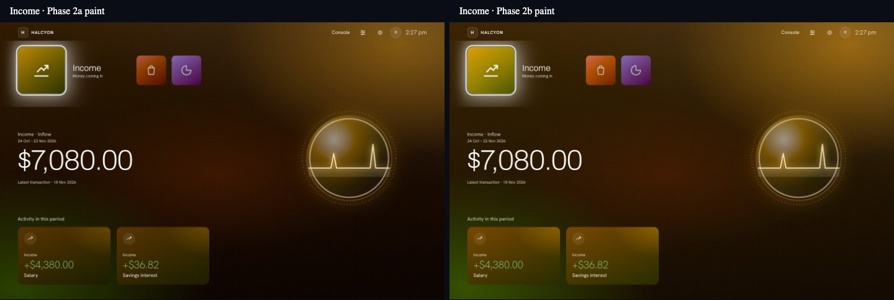
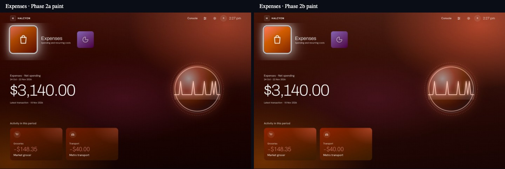

# Console component and screen plan

Phase 1 approved with changes · 22 November 2026

Start on Dashboard. A user can focus Income, see the existing 30-day inflow and open the Income analyzer. Expenses can show the existing spending figure and carry the selected period or category into the analyzer. Accounts can show holdings. This first slice exercises focus, dwell, data presentation and return navigation using information Dashboard already owns. See the [audit](console-audit.md) for current behaviour and the [specification](console-spec.md) for tokens, input events and audio recipes.

## Component boundaries

Proposed props describe ownership. The existing router identifies destinations. A section ID identifies a visual selection. They can differ while someone browses the home row.

| Primitive | Inputs and events | States and responsibilities |
| --- | --- | --- |
| Appearance and effects preferences | Appearance, saved classic light/dark choice, OS motion preference, app motion, reduce effects, sound opt-in, mute, volume, music opt-in | Own the runtime flag, first-paint preference and effective settings above the keyed routes. Console is the future default. Keep the frozen Classic fallback available until removal after Phase 5. On exit release console listeners, timers, animations and audio nodes. Persist presentation preferences only. |
| FocusRing | `kind` (section, activity, control), `active`, native focus-visible, disabled, effective motion | Style the actual button or link, with decorative layers excluded from interaction and accessibility. Rest, focused, pressed, disabled, static/reduced and forced-colours states. Assign scale to a visual child so the hit target and layout slot remain stable. |
| FocusRow | `kind`, labelled ordered items with stable IDs, active ID, `onFocusChange(id)`, `onActivate(id)`, return ID | Own a row-local roving tab stop and input modality. Scope horizontal arrows to the row. Tab exits. Suppress activation after a touch pan. Distinguish hover, DOM focus, pointer activation and the delayed ambient section. Preserve one visible focus anchor when changing modality. Single-action cards open on first activation. |
| AmbientBackground | Committed section hue, effective effects, page visibility, covering overlay, input capability | Keep one gradient mounted per enabled section. Mix their opacity on a committed ambient change. Active, cross-fading, suspended and static. Coalesce pointer input into one frame update. Give touch a stable centre. Clear pending work on section changes, theme exit and unmount. |
| GlassSurface | `kind` (hub, activity, sheet), children, effective effects | Compose the existing glass family. Keep decorative layers separate from content, pick a legible opaque fallback and protect redacted values. Delegate interaction to a real control. |
| ControlCentre | Open state, opener or fallback ref, existing actions, available notices, `onClose` | Labelled modal with one focus owner. Support button and C, Tab/Shift+Tab, Escape, return focus and safe-area scrolling. Suspend the ambient scene while open. Ignore editable targets, composition, modifiers and key repeat, and defer to an existing modal. Provide a way to disable the single-character shortcut. Preserve independent primary navigation. |
| SoundEngine | `unlockFromGesture()`, `play(cue, position?)`, effective sound/music settings, `setMuted`, `setVolume`, `suspend`, `dispose` | Uncreated, running, muted, suspended, unavailable. One master path and reverb send. Throttle hover at the engine boundary. Cancel tails/music on mute, theme exit or sign-out. Never create a context from an effect on reload. Explicitly opting in can override the OS sound default. |
| Motion presets | Token-backed recipe, sibling index, effective motion, cancellable animation owner | Rise, title, overlay, sheet and reverse transitions; static or reduced variants. Keep a single source for times, easing and geometry. Stop superseded work during rapid reversal. Key the figures/cards on focus immediately and keep the report owner mounted. |

Use the development-only foundation demo on the signed-in Dashboard at `/dashboard?demo=foundation` with Console enabled. The demo renders the same primitives, with full, reduced and applicable disabled states. Gate captures use the regular signed-in Dashboard and hubs. A controlled clock, stable focus ID and frozen ambient scene make screenshots repeatable. Audio demos require a real activation and show the selected cue in text.

## Delivery order

| Phase and commit unit | Visible result | Evidence in the commit note |
| --- | --- | --- |
| 2a · Dashboard feel spike | Runtime appearance flag, rough Dashboard section row, ambient background and keyed previews using existing reads | Capture a local Chrome DevTools trace. Stop for owner review before hardening. Automated coverage begins with hardening after the feel review. |
| 2b · Console viewport spike | Full-screen Home, existing-route Overview and Income hubs, and rough Control Centre | Capture Home Overview, Home Income, Overview hub and Control Centre at 1440×900 and 390×844. Include a 10–15s recording, warm-palette comparison and Chrome trace. Stop for owner feel review. |
| 2c · review, then implement | Compare two static Income hub directions. After owner selection, apply the selected language to Income and Overview and make the Home corrections. | First review four static captures and the Ledger and Budget notes. After implementation, capture Income hub, Overview hub and Home Accounts at both sizes, a 20-second walkthrough and a Chrome trace. Stop again for owner review. |
| 2 · Batch 1 foundation | Appearance, scoped tokens, shared motion presets, FocusRing, FocusRow, GlassSurface. Remove the superseded spike code. | Gate 1 captures Home, Income expanded and compact, and Overview at 1440×900 and 390×844. Supply a visual comparison note and run Playwright and axe on those states. Classic gets a render, navigation and browser-console smoke check. Stop for review. |
| 2 · Batch 2 ambient and sound | AmbientBackground, optional start screen and SoundEngine, including music and the sound opt-in in the top bar and Settings. | Gate 2 requires a 30-second walkthrough with audible cues and music, a Reduce-effects capture, and a local Chrome trace measuring ambient work against the 2ms/frame budget. Stop for feel review. |
| 2 · Batch 3 Control Centre and qualification | Harden the full-width bottom sheet, focus trap, shortcut guards and shortcut preference. Qualify the startup, tile paint, effects tiers and master volume. Run the Phase 2 acceptance matrix. | Gate 3 reports pass/fail for each acceptance item and supplies the 1440×900 Balanced trace. Stop before Phase 3. |
| 3 · Dashboard | Harden Home and the Overview hub as separate surfaces, with the phone Overview trend beside the movement figure | Test rapid browsing, open during dwell, Back to the same tile, reading order, redaction, empty/error results and recent-transaction editing. Compare report requests before and after focus movement. Owner Safari visual and interaction check approved. |
| 4A · 4.1 Accounts | Balances and holdings hub | Account selection, balance history, activity, add/edit and provider connection dialogs. Restore the initiating control after a dialog closes. |
| 4A · 4.2 Income | Income summary and projection entry | Date/account filters, analyzer/projections tabs, keyboard chart alternatives and saved planning edits retain their state while appearance changes. |
| 4A · 4.3 Expenses | Spending summary and recurring entry | Category and time filters, recurring directory, calendar and drill-through still agree. Escape dismisses a picker before any hub navigation. |
| 4B · 4.4 Budget | Budget hub with its existing task workspace in focused reading and editing modules | Verify Console owner/member access, draft and interrupted-save recovery, native modal focus and its docked appearance control. |
| 4B · 4.5 Ledger | Ledger hub with a dedicated opaque table module and companion controls | Type C in search, select multiple rows, page, open a full-parent drawer, close and restore focus. Keep a visible ring around the active control within the table. |
| 4B · 4.6 Ingestion | Ingestion hub with its statement-import workspace | Operate file input, mapping, staging and error recovery. Keep progress text, native inputs and the current staged work visible during appearance changes. |
| 4B · 4.7 Transfers | Transfers hub with its review queues | Preserve group selection, queue position, batch confirmation and keyboard operation. |
| 4C · 4.8 Settings | Appearance, sound/volume, reduce effects and shortcut controls in the existing form | Connect final settings presentation to the Phase 2 preference owner. Test native interaction, independent music/mute, OS preference changes and persistence. |
| 4C · 4.9 Landing | Coordinate the existing hero transition with optional signed-in start entry at signed-in home entry | Verify Enter, click, first audio gesture, return home, deep link, sign-out and reduced motion. |
| 5 · cross-screen qualification | Reference comparison, accessibility and performance evidence | Use the matrix below. |

Login, onboarding, callback, password reset and the internal concept route get direct-entry and keyboard regression checks. Their functional forms and recovery routes are unaffected by the home-screen treatment. A section without existing Dashboard data can expose a labelled route action. Hovering it must never query a specialist screen or display a fabricated zero.

Each Phase 4 batch branches from current `main` and stops at its gate. Merge the approved batch before branching the next. Gate 4A covers expanded and compact captures at 1440 and 390, a walkthrough across all three analysis hubs, Playwright/axe and the throttled proxy. Gate 4B covers the full Ledger categorisation, Budget allocation, import staging and transfer confirmation workflows with existing and Console browser tests. Gate 4C covers Settings and Landing/start entry and stops before Phase 5.

## Analysis hubs on phones

- Batch 4A puts the analysis filters below the expanded hero on phone widths. The compact Income header carries Home, the section figure and analyzer/projections tabs.

## Review reproduction

[Phase 2 Gate 1 review and captures](console-phase-2-gate-1.md) · [Phase 2 Gate 2 walkthrough and trace](console-phase-2-gate-2.md) · [Phase 2 Gate 3 acceptance and Balanced trace](console-phase-2-gate-3.md) · [Phase 3 review and device gate](console-phase-3-review.md).

[Gate 4A review and phone proxy](console-phase-4a-review.md).

Start each review note with the **branch, commit, worktree path, exact dev-server command and URL**, followed by a capture of that URL.

Record every capture and walkthrough on the signed-in route of the actual dev server named in the note. Use either a seeded local account or a data-source switch at the API boundary on that same route for fictional values. The review browser and personal browser load the same app entry, route, appearance flag and shell.

When reusing a preview port, verify the listener’s working directory and the served app source before trusting it. Restart a stale process from the named worktree. Reopen the documented URL, sign in and activate Console to verify the viewport shell before recording. Keep real-account confirmation separate from fictional-data recording.

## Acceptance evidence

- **Classic leftovers.** Run the rendered Console audit on each Phase 4 batch and record its output in the gate note. Check sentence-case interface labels, the Console module-title token, Classic accent colours, the Console variant of chips, selects and inputs, and house dates. Exempt proper nouns and record-supplied text from casing. Exercise the routes at desktop and phone widths in the normal signed-in app.

- **Appearance and layout.** Capture the same fictional state at 320, 390, 768, 1024 and 1440px. Compare Console against the supplied target. Include the first and last tile, long names, ring edges, an open overlay, and 200% zoom. Check focus-induced layout shift independently of the intended track transform.
- **Classic fallback.** Smoke-check rendering, navigation and browser console errors while the frozen fallback remains available. Remove Classic after Phase 5.
- **Input and accessibility.** Use Playwright and axe on real states, then operate each row and dialog using keyboard and touch. Inspect accessible names, focus restoration, visible labels, both signed-figure colours against each section’s gradient extremes, including Spending 35° against negative 25°, forced colours and native controls. Verify that navigation works while the entrance is playing.
- **Effects and sound.** Test fresh/off, explicit opt-in, persisted opt-in before/after a gesture, muted, zero volume, music off/on, unavailable Web Audio, OS reduce and explicit override. Combine OS reduce and in-app Reduce effects separately and together. Verify no ambient movement when reduced or obscured, no decorative blur/particles with Reduce effects, 150ms reduced entrances and visible feedback for every cue.
- **Performance.** Halcyon is desktop-first. The owner’s visual and interaction check in Safari on the physical 2020 M1 MacBook Air satisfies the device gate. Run a local Mac Chrome DevTools trace per implementation commit. Each phase includes a 390×844 Chrome trace at 4× CPU throttle in Balanced with a matched Reduce-effects baseline. Report ambient-added CPU mean and p95 per frame (Balanced minus Reduce) and the longest navigation task. Record rapid focus, dwell, open/Back, overlay and visibility changes. The phone layout is supported and automatically uses Balanced on coarse-pointer devices. Mobile performance is unmeasured on hardware. [Safari check and results template](console-phase-3-device-gate.md).
- **Regression scope.** Inspect both CSS animations and JS targets for layout properties, animated shadows and tracking. Log the screen or primitive, what changed, fixture, checks run, artifacts and any unverified targets in each commit. New product components and views also trigger the repository's index update rule.

Anime.js v4 dependency and chart parity work are tracked as a separate follow-up. Framer Motion 11 and CSS consume the same console motion tokens while the chart adapter stays on v3.

## Phase 2a review

In the Phase 2a spike, the signed-in Dashboard offered **Console** in the top bar. Hover a section and click once to open it. Use the arrow keys in the section row and Enter to open, or tap a tile twice on touch. The header control returns to the saved classic appearance. This slice includes the section tiles, Overview, Income and Expenses activity, existing Dashboard totals, and directional ambient light. The full material stack, sound, Control Centre and primitive demos come after the feel review.

The Chrome DevTools Performance trace uses a fictional signed-in Dashboard on a 1440×900 viewport in local Chrome 157. It records pointer movement, rapid keyboard changes, the background dwell and colour cross-fade. Load the compressed recording in Chrome’s Performance panel. Physical-device traces and contrast qualification are phase gates. [Phase 2a Chrome trace](traces/console-phase-2a-chrome.json.gz)

Phase 4 extends the chosen hub language to each screen by restyling shared components in place for Console. Individual charts, forms and tables keep their controls and use their own reading surfaces. The ambient scene and global actions belong to the same viewport as Home.

### Phase 2b review artifacts

Open Dashboard in the signed-in app and select **Console** beside the appearance control. In Console, select a tile to enter its hub, then use **Back to Home** or Escape. Press **C** or the top-bar Control Centre button for the review and utility routes. The short recording follows Overview, Accounts, Income, the Income hub, Back and the Control Centre.

The captures use matching fictional data. The palette comparison holds geometry and data constant and replaces just the warm paint values with Phase 2a values for the before panels.

| State | 1440 × 900 | 390 × 844 |
| --- | --- | --- |
| Home · Overview | [Desktop](captures/console-phase-2b/1440-home-overview.jpg) | [Phone](captures/console-phase-2b/390-home-overview.jpg) |
| Home · Income | [Desktop](captures/console-phase-2b/1440-home-income.jpg) | [Phone](captures/console-phase-2b/390-home-income.jpg) |
| Overview hub | [Desktop](captures/console-phase-2b/1440-overview-hub.jpg) | [Phone](captures/console-phase-2b/390-overview-hub.jpg) |
| Control Centre open | [Desktop](captures/console-phase-2b/1440-control-centre.jpg) | [Phone](captures/console-phase-2b/390-control-centre.jpg) |

[13-second walkthrough](captures/console-phase-2b/walkthrough.webm) · [Local Chrome DevTools Performance trace](traces/console-phase-2b-chrome.json.gz)

## Phase 2c · Income hub directions

Both directions use the same fictional 30-day report. $7,080 in inflow and $3,140 in spending leave $3,940 after spending. Dates, deposit amounts, source shares and chart series refer to that same fixture. The focus ring in each capture illustrates an active module. These are static design studies.

| Direction | 1440 × 900 | 390 × 844 |
| --- | --- | --- |
| A · Game hub | [Desktop capture](captures/console-phase-2c/game-hub-1440.png) | [Phone capture](captures/console-phase-2c/game-hub-390.png) |
| B · Analysis workspace | [Desktop capture](captures/console-phase-2c/analysis-workspace-1440.png) | [Phone capture](captures/console-phase-2c/analysis-workspace-390.png) |

### A · Game hub

The translucent hero continues the visual rhythm of Home. It gives the report’s name, inflow and dates one clear place, with an actual retained-income ratio in the key art. A horizontal row carries secondary metrics, followed by independently surfaced analysis and activity. On phone, the metric strip scrolls sideways and the deeper modules stack.

- **Ledger.** Use a shorter route header and a row of All, Needs review and Uncategorised views. Keep search and filters directly above one opaque transaction table. The table keeps its own horizontal overflow and row controls.
- **Budget.** Open on the selected period and its primary figure. Keep overview metrics on the browse row. Group editable fields into separately surfaced tasks such as allocations and goals, with save and recovery controls inside the relevant task.

### B · Analysis workspace

A compact header and filters lead directly to the cash-flow chart. The headline is inside the chart module, where it explains the end of the inflow line. A smaller column pairs period balance with recent deposits, and the ambient scene runs through the two columns. On phone, the chart comes first and the other modules follow the reading order vertically.

- **Ledger.** Put the table in the main work area and move review counts and data scope to compact companion modules. On phone, put filters above the table and move secondary summaries after it. Keep table scanning, selections and pagination together.
- **Budget.** Put the active form in the main work area, with totals and the effect of changes in an adjacent summary. On phone, place a compact funding readout before the form and keep its fields, validation and save action together.

### Selected implementation and review

The owner chose A’s game-hub entry and B’s compact header and body. Income and Overview share the entry morph and sticky scroll collapse. Home adds cumulative art, Holdings cards from the existing account directory, unclipped selection glow, and whole-dollar headline figures. Control Centre places review cards above round quick actions.

The implementation review captures Income expanded and compact, Overview expanded, Home Accounts and Control Centre in both sizes. The 20-second sequence starts on Home with Income focused, enters the hub, scrolls down and back up, returns Home, then browses Accounts before opening Overview. Pause for review before hardening.

| State | 1440 × 900 | 390 × 844 |
| --- | --- | --- |
| Income hub · expanded | [Desktop](captures/console-phase-2c/implementation/1440-income-expanded.jpg) | [Phone](captures/console-phase-2c/implementation/390-income-expanded.jpg) |
| Income hub · compact | [Desktop](captures/console-phase-2c/implementation/1440-income-compact.jpg) | [Phone](captures/console-phase-2c/implementation/390-income-compact.jpg) |
| Overview hub · expanded | [Desktop](captures/console-phase-2c/implementation/1440-overview-expanded.jpg) | [Phone](captures/console-phase-2c/implementation/390-overview-expanded.jpg) |
| Home · Accounts | [Desktop](captures/console-phase-2c/implementation/1440-home-accounts.jpg) | [Phone](captures/console-phase-2c/implementation/390-home-accounts.jpg) |
| Control Centre | [Desktop](captures/console-phase-2c/implementation/1440-control-centre.jpg) | [Phone](captures/console-phase-2c/implementation/390-control-centre.jpg) |

The original implementation captures used fictional data on a separate dev listener. They are historical review evidence. See the [reproduction report](console-phase-2c-reproduction.md) for the verified 5320 build and replacement evidence. [20-second walkthrough](captures/console-phase-2c/implementation/walkthrough.webm) · [Chrome DevTools Performance trace](traces/console-phase-2c-chrome.json.gz)
